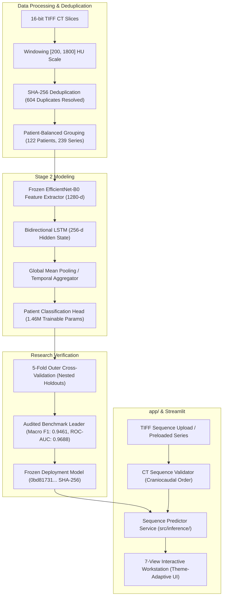

# PulmoVision

**Thoracic CT Sequence Intelligence & AI Medical Imaging Research Platform**

[](https://pulmovision-lungctscan-ai.streamlit.app/?page=Research+Overview)
**Live Application:** [pulmovision-lungctscan-ai.streamlit.app](https://pulmovision-lungctscan-ai.streamlit.app/?page=Research+Overview)

PulmoVision is an educational and scientific research prototype that investigates 2.5D deep sequence modeling across multi-slice thoracic CT scans. By coupling frozen 2D convolutional feature extraction (EfficientNet-B0) with recurrent sequence aggregation (Bidirectional LSTM), the platform models anatomical continuity along the craniocaudal axis while maintaining computational efficiency and parameter economy on standard hardware.

> **Research Prototype Disclaimer:** PulmoVision is strictly an academic research and educational prototype. It is **NOT** a certified medical diagnostic device, clinical decision-support system, or medical diagnostic tool. Predictions and model scores represent uncalibrated empirical research outputs and must never be utilized for patient diagnosis, clinical triage, or treatment planning.

---

## Key Research & Engineering Highlights

- **2.5D Deep Sequence Modeling:** Decouples in-plane spatial feature extraction from craniocaudal sequence modeling. Captures axial anatomical continuity without the cubic memory scaling of full 3D isotropic convolutions.
- **Cross-Validation Leader (Architecture B):** Evaluated across 15 nested outer/inner cross-validation runs on 122 patients (3,132 canonical slices). EfficientNet-B0 + BiLSTM + Global Mean Pooling achieved **0.9461 Macro F1**, **0.9688 ROC-AUC**, **0.9760 PR-AUC**, **98.70% Sensitivity** (76/77 COVID-19 cases detected, 1 false negative), and **88.89% Specificity** (40/45 Normal cases).
- **Forensic Deduplication & Provenance:** SHA-256 hashing resolved 604 redundant duplicate slice aliases down to 3,132 canonical anatomical slices across 239 patient acquisition series.
- **Patient-Balanced Optimization:** Enforced equitable patient loss weighting ($w_i = 1 / N_p$ per series, grouped per patient) to prevent gradient dominance from over-sampled CT series.
- **Strict Sealed Holdout Quarantine:** The official test partition (`test1.csv`) remains 100% sealed, unopened, unread, and untouched throughout development and validation.
- **Enterprise Modular Workstation:** Re-architected into 7 dedicated view destinations, 7 reusable component libraries, dual visual themes (**Clinical Dark** and **Laboratory Light**), and a pitch-black (`#000000`) radiological viewport invariant with zero unicode emojis.
- **Automated QA & Regression:** Comprehensive test suite of **108 / 108 passing tests (100% green)** across data, deduplication, architectures, patient weighting, sequence validation, manifest schema adapters, deployment readiness, and UI modules.

---

## Platform Architecture

PulmoVision maintains a strict separation between the offline research/training pipeline and the live inference application:



---

## Experimental Benchmark Results

Stage 2 evaluated three sequence architectures using identical 5-fold patient-stratified splits ($77$ COVID-19, $45$ Normal patients):

| Architecture ID | Model Description | Trainable Params | Macro F1 | ROC-AUC | PR-AUC | Sensitivity | Specificity | False Negatives |
| :--- | :--- | :---: | :---: | :---: | :---: | :---: | :---: | :---: |
| **Experiment A** | EfficientNet-B0 + Atemporal Mean Pooling | 82,114 | 0.8236 | 0.8652 | 0.9046 | 77.92% | 91.11% | 17 / 77 |
| **Experiment B [Leader]** | EfficientNet-B0 + BiLSTM + Mean Pooling | 1,460,418 | **0.9461** | **0.9688** | **0.9760** | **98.70%** | 88.89% | **1 / 77** |
| **Experiment C** | EfficientNet-B0 + BiLSTM + Additive Attention | 1,460,675 | 0.9211 | 0.9466 | 0.9466 | 93.51% | **91.11%** | 5 / 77 |

*Note: Operating threshold is fixed at $\tau = 0.50$ across all architectures.*

---

## Application Navigation & Workstation Destinations

The application features 7 distinct views accessible via the sidebar navigation:

1. **Research Overview:** Executive dashboard presenting research objectives, verified benchmark tables, model parameter comparisons, and topological pipeline diagrams.
2. **Dataset Explorer:** Searchable, interactive manifest explorer powered by `ManifestAdapter`. Enables filtering by COVID-19 vs. Normal, patient/series searching, and inspecting provenance for all 604 resolved duplicate aliases.
3. **Model Laboratory:** Technical comparison analyzing why 2.5D sequence models outperform both isolated 2D slice classifiers and true 3D volumetric CNNs on memory, compute, and patient-level accuracy.
4. **Experiment Analytics:** Interactive visualization of cross-validation ROC curves, PR curves, fold-wise F1 distributions, threshold sweeps, and audited confusion matrices.
5. **CT Workstation:** Clinical-style sequence workstation. Validates uploaded 16-bit TIFF CT series, enforces craniocaudal slice ordering, displays dynamic radiodensity windowing on a pitch-black viewport, and executes live sequence inference with latency profiling ($~133\text{ ms/slice}$).
6. **Explainability & Boundaries:** Visualizes Grad-CAM saliency maps overlaid on pulmonary parenchyma, temporal sequence attention weights, and documents clinical failure modes (motion artifacts, atelectasis, non-specific opacities).
7. **Research Documentation:** In-app markdown reader dynamically rendering formal technical reports, including the Stage 2 Research Report, Forensic Audit Report, and Final Sign-off Audit.

---

## Directory Structure

```text
PulmoVision/
├── app/                              # Modular Streamlit Web Workstation
│   ├── components/                   # Reusable UI widgets (cards, charts, tables, diagrams)
│   ├── styles/                       # CSS design tokens, typography, and theme engines
│   ├── utils/                        # Data loaders, paths, and manifest adapters
│   ├── views/                        # 7 dedicated destination views
│   └── streamlit_app.py              # Main application coordinator and router
├── configs/                          # Experiment configuration YAMLs
├── data/
│   ├── metadata/                     # Manifests, splits, and deduplication records
│   └── raw/                          # Raw CT slice repositories (git-ignored)
├── docs/                             # Architecture specs and project tracking
├── models/                           # Serialized PyTorch model checkpoints (git-ignored)
├── reports/
│   ├── experiments/                  # Forensic audit and QA sign-off reports
│   ├── figures/                      # High-resolution application screenshots
│   └── research/                     # Formal Stage 2 research reports
├── scripts/                          # Automated screenshot and acceptance verification scripts
├── src/                              # Core Python research and engineering packages
│   ├── data/                         # 16-bit TIFF loading, deduplication, and windowing
│   ├── evaluation/                   # Nested cross-validation and patient-level metrics
│   ├── features/                     # Feature extraction and caching engines
│   ├── inference/                    # Sequence validation and inference services
│   ├── models/                       # CNN backbones and BiLSTM sequence architectures
│   └── training/                     # Patient-balanced training loops
└── tests/                            # Automated test suite (95 tests)
```

---

## Quickstart & Deployment Options

### Option 1: Streamlit Community Cloud (Live Demo & Cloud Hosting)

- **Live Workstation:** [pulmovision-lungctscan-ai.streamlit.app](https://pulmovision-lungctscan-ai.streamlit.app/?page=Research+Overview)
- **App Entrypoint:** `streamlit_app.py` (root entrypoint shim delegating to `app/streamlit_app.py`)
- **Python Version:** 3.10, 3.11, or 3.12
- **Resource Footprint:** ~468 MB peak RAM (well within free tier 2.7 GB limit)
- **Inference Speed:** ~150 ms/slice on standard free-tier CPU cores

**Steps to Deploy:**
1. Fork or push this repository to GitHub.
2. Sign in to [Streamlit Community Cloud](https://share.streamlit.io/).
3. Click **New app**, select your repository and branch (`main` or `feature/docker-deployment`).
4. Set Main file path to `streamlit_app.py` (auto-detected).
5. Click **Deploy!**

### Option 2: Local Python Environment

#### Prerequisites
- macOS (Apple Silicon MPS accelerated) or Linux / Windows (CUDA or CPU)
- Python 3.10 to 3.13

#### 1. Clone & Set Up Virtual Environment
```bash
git clone https://github.com/geetikavasistha-01/PulmoVision.git
cd PulmoVision

python3 -m venv venv
source venv/bin/activate  # On Windows: venv\Scripts\activate
pip install --upgrade pip
pip install -r requirements.txt
```

#### 2. Launch the Research Workstation
```bash
streamlit run app/streamlit_app.py
```
Open [http://localhost:8501](http://localhost:8501) in your browser. The application supports toggling between **Clinical Dark** and **Laboratory Light** themes via the sidebar control.

#### 3. Run Automated Tests
```bash
# Install development test dependencies
pip install -r requirements-dev.txt

# Execute full 108-test regression suite
pytest tests/ -v

# Run targeted acceptance verification on real TIFF CT sequence
python scripts/verify_acceptance.py
```

### Option 3: Docker Container Deployment

Run the isolated, production-hardened container locally:

```bash
# Build and run with Docker Compose
docker compose up --build

# Access the running workstation at:
# http://localhost:8501
```

---

## Git Workflow & Five-Branch Strategy

PulmoVision strictly adheres to a local five-branch engineering model:
```text
main                                    [Production-ready research release]
 ├── feature/cnn-bilstm                 [Stage 2 sequence modeling & modular UI]
 ├── feature/streamlit-deployment       [Stage 1 Streamlit deployment & serving]
 ├── feature/evaluation-xai             [Metrics, confusion matrices & Grad-CAM]
 └── feature/model-development          [CNN architectures & baseline training]
```

### Project Invariants
1. **Zero Test Set Contamination:** `data/metadata/Annotation/CSV/test1.csv` is strictly sealed and never accessed during development or tuning.
2. **Patient-Level Stratification:** Cross-validation folds are strictly partitioned by `patient_id`. Zero slice-level leakage is permitted.
3. **Anatomical Integrity:** Only physiologically valid CT augmentations (subtle in-plane rotations, horizontal flips) are permitted; vertical flips and color jitter are prohibited.
4. **Zero Emojis in Production UI:** All user interface elements utilize standard Streamlit Material Symbols or vector SVGs.

---

## Limitations & Ethical Considerations

- **Single-Source Data Bias:** Primary development was conducted on the COVID-CTset dataset originating from a single hospital system. Model generalizability across external clinical centers and alternative CT scanner manufacturers (e.g., GE, Siemens, Philips) remains unproven.
- **Non-Specific Radiographic Features:** Ground-glass opacities (GGOs) and consolidations captured by Grad-CAM are characteristic of viral pneumonias in general and are not pathognomonic for COVID-19. They can mimic influenza, bacterial pneumonia, or organizing pneumonia.
- **Uncalibrated Probability Scores:** Network outputs reflect discriminative sigmoid scores, not true Bayesian posterior probabilities.
- **Single-Slice Fallback ($T=1$):** Sequences containing only 1 slice bypass temporal recurrence, operating purely on static feature projection with diminished sensitivity.

---

## License & Attribution

This project is developed for educational and scientific research purposes under the **CC BY 4.0** license. CT imaging data derived from the open-access COVID-CTset collection.
