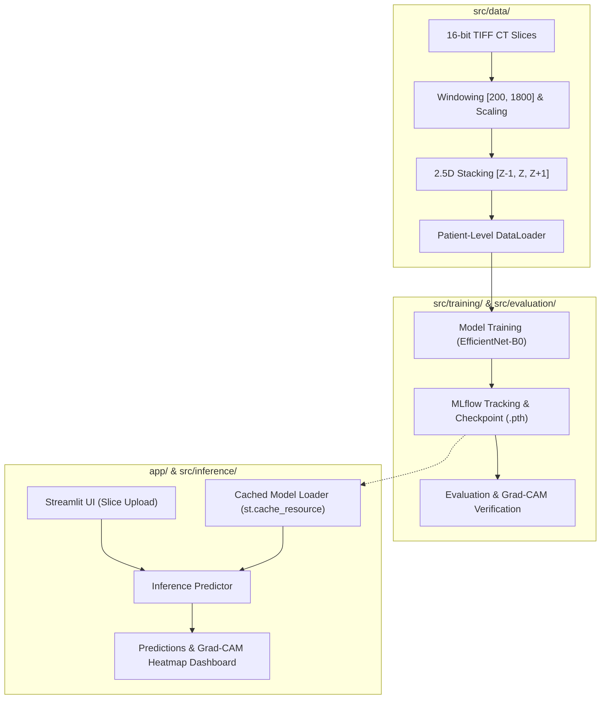

# 🫁 PulmoVision

> **2.5D Medical Image Deep Learning Research Prototype for Thoracic CT Scans**  
> Educational research platform analyzing multi-slice chest CT volumes with explainable AI (Grad-CAM).

⚠️ **Disclaimer:** This is an educational research prototype, **NOT** a diagnostic tool. Dataset categories must never be interpreted as confirmed clinical diagnoses.

---

## 📋 Developer & Architecture Guide (FAQ)

### 1. What does this project do?
PulmoVision classifies chest CT scans into research categories (COVID-19 vs. Normal) using **2.5D deep learning**. Instead of analyzing single isolated 2D slices or requiring computationally heavy 3D convolutions, it stacks adjacent anatomical slices into multi-channel inputs, capturing through-plane spatial depth while generating Grad-CAM visual heatmaps.

| Capability | Technical Mechanism |
|---|---|
| **2.5D Stacking** | Adjacent CT slices $[Z-1, Z, Z+1]$ stacked as channels `[3, 224, 224]` |
| **Model Backbones** | Custom CNN baseline, ResNet50, EfficientNet-B0 (with ImageNet transfer learning) |
| **Explainability** | Grad-CAM activation maps overlaid on original anatomical scans |
| **User Interface** | Interactive Streamlit web application with cached model inference |

---

### 2. Why was it built?
Built as an end-to-end, milestone-driven educational research system to demonstrate:
1. **Medical AI Data Discipline:** Overcoming data leakage through strict patient-level (not slice-level) partitioning.
2. **2.5D Modelling Trade-offs:** Balancing volumetric context vs GPU/CPU computational efficiency.
3. **High Dynamic Range Processing:** Handling 16-bit CT radiodensities ($[0, \approx 2200]$) and anatomical windowing.
4. **Reproducible ML Engineering:** Programmatic dataset auditing, experiment tracking (MLflow), and cloud-ready serving.

---

### 3. How is it architected?

PulmoVision maintains a strict logical separation between the **offline training pipeline** and the **online inference application**:



---

### 4. Where is the entry point?

| Workflow | Entry Point File | Command to Run |
|---|---|---|
| **Web Application** | [`app/streamlit_app.py`](file:///Users/geetikavasistha/PulmoVision/app/streamlit_app.py) | `streamlit run app/streamlit_app.py` |
| **Dataset Audit** | [`src/data/dataset_audit.py`](file:///Users/geetikavasistha/PulmoVision/src/data/dataset_audit.py) | `python src/data/dataset_audit.py` |
| **Chart Generation** | [`src/data/generate_charts.py`](file:///Users/geetikavasistha/PulmoVision/src/data/generate_charts.py) | `python src/data/generate_charts.py` |
| **Model Training** | `src/training/train.py` | `python src/training/train.py --config configs/training.yaml` |

---

### 5. Where is the business logic?

All modular engineering logic resides strictly in [`src/`](file:///Users/geetikavasistha/PulmoVision/src/):

| Subsystem | Directory | Core Responsibilities |
|---|---|---|
| **Data & Preprocessing** | [`src/data/`](file:///Users/geetikavasistha/PulmoVision/src/data/) | 16-bit TIFF loading, windowing, safe augmentations, 2.5D slice grouping |
| **Model Architectures** | [`src/models/`](file:///Users/geetikavasistha/PulmoVision/src/models/) | Custom CNN, ResNet50, EfficientNet-B0 with multi-slice input adapters |
| **Training Pipeline** | [`src/training/`](file:///Users/geetikavasistha/PulmoVision/src/training/) | Epoch loops, loss weighting, mixed-precision, MLflow logging |
| **Evaluation Metrics** | [`src/evaluation/`](file:///Users/geetikavasistha/PulmoVision/src/evaluation/) | Patient-level confusion matrices, Macro F1, balanced accuracy |
| **Explainable AI (XAI)** | [`src/explainability/`](file:///Users/geetikavasistha/PulmoVision/src/explainability/) | Hook-based Grad-CAM generation on target convolutional layers |
| **Inference Engine** | [`src/inference/`](file:///Users/geetikavasistha/PulmoVision/src/inference/) | Standalone lightweight prediction service consumed by Streamlit |

---

### 6. How do I run it locally?

#### Prerequisites
- macOS / Linux / Windows with Python 3.10–3.13
- Apple Silicon (Metal MPS) or NVIDIA GPU supported (CPU fallback available)

```bash
# 1. Clone the repository
git clone https://github.com/geetikavasistha-01/PulmoVision.git
cd PulmoVision

# 2. Set up virtual environment
python3 -m venv venv
source venv/bin/activate  # On Windows: venv\Scripts\activate

# 3. Install dependencies
pip install --upgrade pip
pip install -r requirements.txt

# 4. Configure credentials (Optional for Kaggle dataset downloads)
cp .env.example .env
# Edit .env with your KAGGLE_USERNAME and KAGGLE_KEY

# 5. Launch the Streamlit application
streamlit run app/streamlit_app.py
```

---

### 7. How do I test my changes?

We use `pytest` for automated test-driven development:

```bash
# Run all unit tests
python -m pytest tests/

# Run preprocessing tests specifically with verbose output
python -m pytest tests/test_preprocessing.py -v
```

| Test File | Validated Constraints |
|---|---|
| [`tests/test_preprocessing.py`](file:///Users/geetikavasistha/PulmoVision/tests/test_preprocessing.py) | Tensor output `[1, 224, 224]`, dtype `float32`, bounds `[0.0, 1.0]`, NaN/Inf checks |
| `tests/test_data.py` | Patient grouping integrity, sequential slice indexing, zero patient leakage |
| `tests/test_models.py` | Multi-channel input adapters, forward pass tensor dimensions |

---

### 8. How can I contribute without breaking something?

Follow the **5-Branch Git Strategy** and the project safety invariants:

```
main (stable, deployable)
 ├── feature/data-pipeline          (Modules 0–3: Data discovery, audit, preprocessing)
 ├── feature/model-development      (Modules 4–7: CNNs, 2.5D stacking, training)
 ├── feature/evaluation-xai         (Modules 8–9: Metrics, Grad-CAM, error analysis)
 └── feature/streamlit-deployment   (Modules 10–12: Web app, latency optimization, tests)
```

#### Contribution Rules
1. **Never commit patient data, raw scans, or model weights (`.pth`):** Kept ignored via `.gitignore`.
2. **Never split data at the slice level:** Always split at the `Patient ID` level to prevent data leakage.
3. **Always run unit tests before submitting a PR:** `python -m pytest tests/` must pass 100%.
4. **Preserve safe CT augmentations:** Never introduce vertical flips (anatomically invalid for standing/supine chest CTs) or color jitter (destroys radiodensity calibration).
5. **Keep Streamlit stateless and cached:** Model loading must use `@st.cache_resource`.

---

## 📊 Dataset & Visual Artifacts

For detailed charts on patient distribution, 16-bit CT intensity histograms, and pipeline flow diagrams, visit:
📁 [`docs/data_and_pipeline_overview/`](docs/data_and_pipeline_overview/)

## 📜 License
Educational and research usage under CC BY 4.0.
