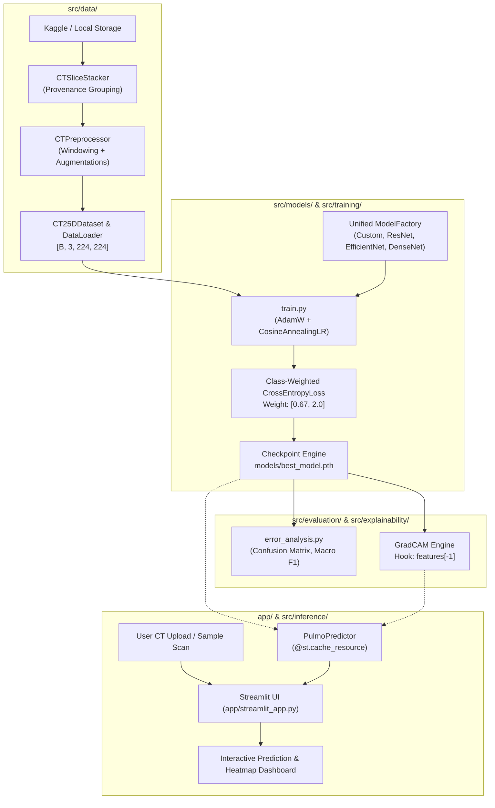

# PulmoVision — System Architecture Specification

This document details the architectural boundaries, package structure, and data flows of the PulmoVision platform.

---

## 1. System Overview

PulmoVision enforces strict decoupling between the **offline training pipeline** and the **online inference application**:



---

## 2. Directory Hierarchy & Package Responsibilities

```
PulmoVision/
├── app/
│   └── streamlit_app.py              # Main Streamlit web dashboard
├── configs/
│   └── training.yaml                 # Centralized training & data hyperparameters
├── docs/
│   ├── architecture.md               # System architecture documentation
│   ├── methodology.md                # Medical AI methodology & windowing math
│   ├── model_card.md                 # Formal model card
│   ├── interview_guide.md            # Technical interview Q&A guide
│   ├── deployment_guide.md           # Cloud & Docker deployment instructions
│   └── PROJECT_PROGRESS.md           # Master 13-module progress tracker
├── models/
│   ├── README.md                     # Checkpoint instructions
│   └── best_model.pth                # Trained 2.5D EfficientNet-B0 weights (46 MB)
├── reports/
│   ├── dataset_audit/                # COVID-CTset audit findings
│   ├── experiments/                  # Evaluation reports & metrics
│   └── figures/                      # Confusion matrix, loss curves, Grad-CAM overlays
├── src/
│   ├── data/
│   │   ├── dataset_audit.py          # Metadata verification script
│   │   ├── preprocessing.py          # 16-bit CT windowing & safe augmentations
│   │   ├── slice_stacking.py         # 2.5D triplet grouping & boundary clamping
│   │   └── dataloader.py             # PyTorch CT25DDataset & DataLoader factory
│   ├── models/
│   │   ├── custom_cnn.py             # 93K parameter baseline CNN
│   │   ├── resnet.py                 # ResNet50 with adapted 2.5D input & head
│   │   ├── efficientnet.py           # EfficientNet-B0 primary candidate
│   │   ├── densenet.py               # DenseNet121 feature-reuse candidate
│   │   └── model_factory.py          # Unified model instantiation factory
│   ├── training/
│   │   ├── train.py                  # Main training loop with class weights
│   │   ├── validate.py               # Deterministic validation & Macro F1
│   │   ├── checkpoint.py             # Atomic checkpoint saving and loading
│   │   └── train_baseline_mini.py    # Overfitting demonstration script
│   ├── evaluation/
│   │   ├── metrics.py                # Sensitivity, Specificity, Macro F1
│   │   ├── confusion_matrix.py       # Clinical confusion matrix visualizer
│   │   └── error_analysis.py         # End-to-end evaluation runner
│   ├── explainability/
│   │   ├── gradcam.py                # Hook-based Grad-CAM implementation
│   │   └── demo_gradcam.py           # Grad-CAM demonstration script
│   └── inference/
│       ├── predictor.py              # Cached prediction service
│       └── benchmark_latency.py      # CPU & MPS latency benchmarking tool
└── tests/                            # 20/20 Automated unit tests
```

