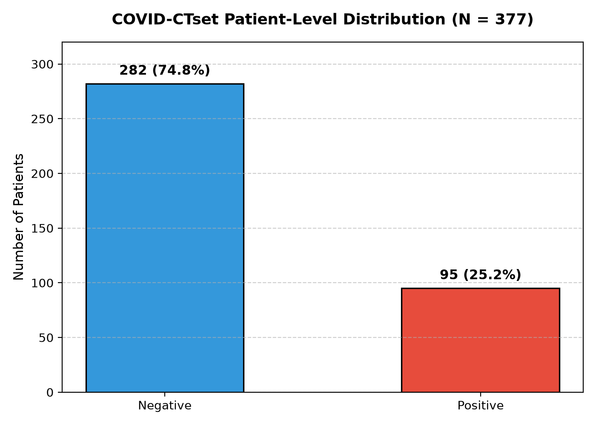
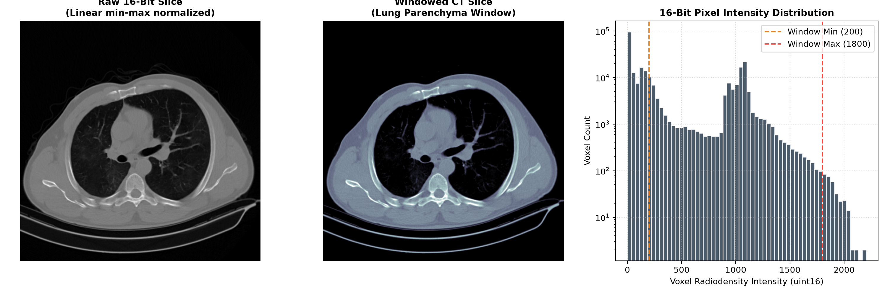
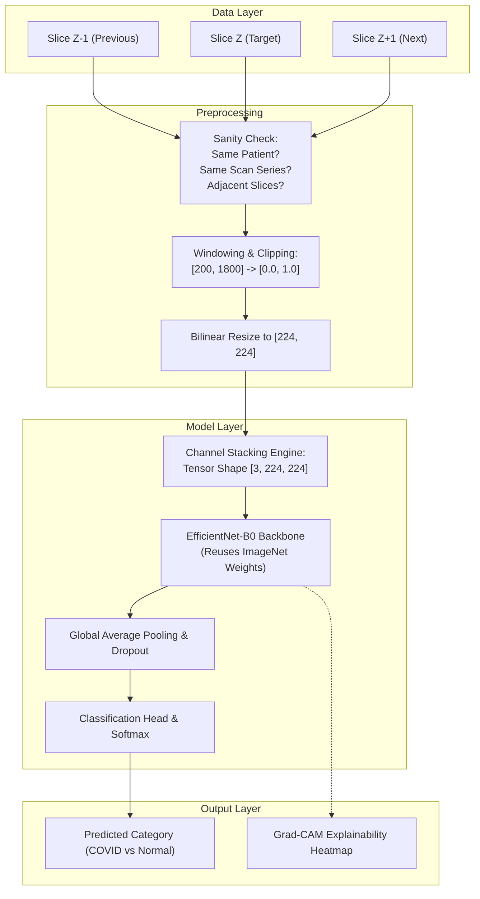
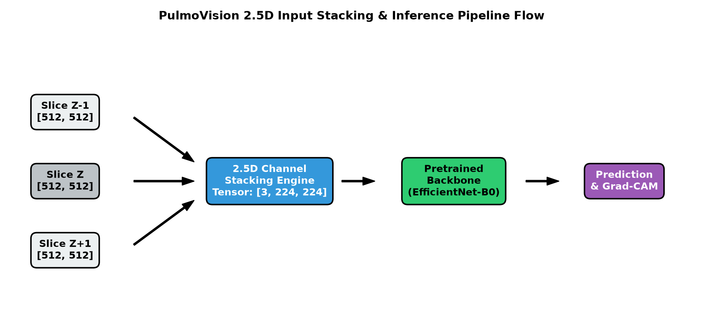

# PulmoVision — Data & Pipeline Architecture Overview

This document provides a consolidated breakdown of the data distribution, CT intensity characteristics, and the 2.5D deep learning pipeline flow implemented in PulmoVision.

---

## 1. Patient Class Distribution

The primary dataset (**COVID-CTset**) comprises 377 unique patients collected at Negin Medical Center using a Siemens SOMATOM Scope CT scanner.

| Diagnostic Category | Patient Count | Percentage | Primary Ground Truth |
|---|---|---|---|
| **Normal / Negative** | 282 | 74.8% | Clinical evaluation, negative pulmonary findings |
| **COVID-19 Positive** | 95 | 25.2% | RT-PCR laboratory confirmation + bilateral ground-glass opacity CT consensus |
| **Total Cohort** | **377** | **100.0%** | Single-center Iranian cohort (March–April 2020) |



> **Key takeaway:** The $1:3$ class ratio requires weighted loss functions (`CrossEntropyLoss(weight=...)`) and balanced evaluation metrics (Macro F1, Balanced Accuracy) rather than unweighted accuracy.

---

## 2. 16-Bit CT Intensity & Lung Windowing Analysis

Unlike standard 8-bit camera photographs ($[0, 255]$), chest CT scans in this dataset are recorded in **16-bit unsigned integer grayscale (`uint16`)** format.

| Property | Value | Architectural Implication |
|---|---|---|
| **Matrix Size** | $512 \times 512$ pixels | High spatial detail; resized to $224 \times 224$ for standard CNN backbones |
| **Dynamic Range** | $[0, 2204]$ | Shifted Hounsfield-derived radiodensities |
| **Display Challenge** | Appears pure black in standard image viewers | Requires windowing and dynamic range scaling |
| **Optimal Window** | $[200, 1800]$ | Maximizes contrast across lung parenchyma and ground-glass lesions |



---

## 3. 2.5D Stacking & Inference Pipeline Flow

PulmoVision leverages neighbouring CT slices as separate input channels to provide the neural network with inter-slice anatomical context without the computational burden of 3D convolutions.





---

## 4. Verification & Zero Data-Leakage Protocol

1. **Patient-level separation:** Slices are grouped strictly by patient ID (`patient1`, `patient2`, etc.).
2. **Zero overlap:** In the official 5-fold cross validation split, Fold 1 has **0 patient overlap** between Train (122 patients) and Test (255 patients).
3. **Reproducibility:** All charts and analyses in this folder can be regenerated by running:
   ```bash
   python src/data/generate_charts.py
   ```

