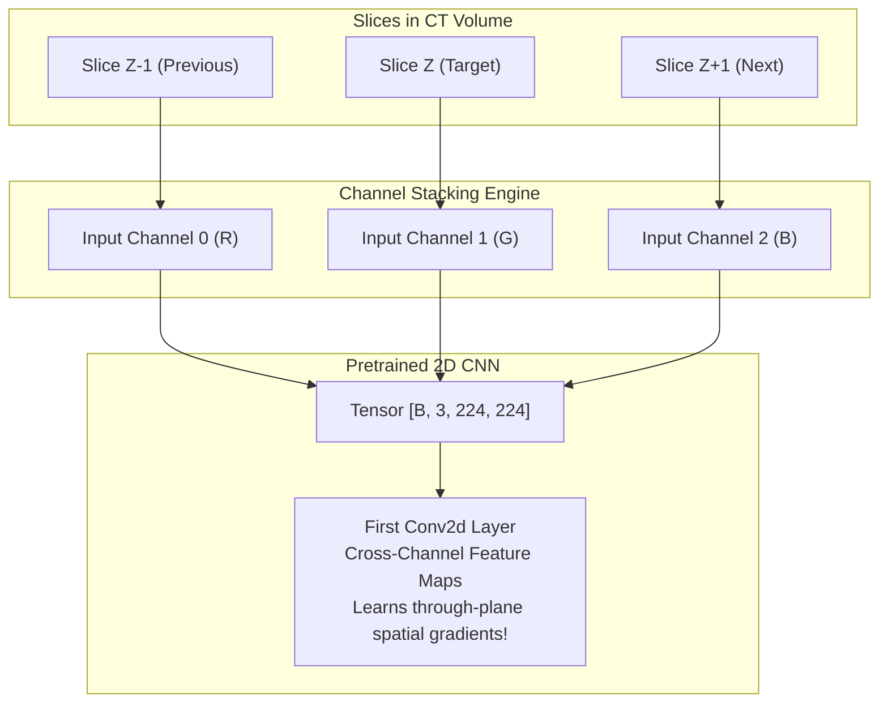

# PulmoVision — Research & Engineering Methodology

This document outlines the end-to-end scientific and engineering methodology guiding PulmoVision Stage 1.

---

## 1. The 2.5D Modelling Paradigm

Standard computer vision treats images as independent 2D projections. In clinical thoracic radiology, a lesion (e.g. peripheral ground-glass opacity) has physical 3D depth and traverses multiple consecutive axial cross-sections.



### Why 2.5D Outperforms Naive 2D and 3D:
1. **Volumetric Context without 3D Compute Overhead:** 3D CNNs require cubic convolutions ($K \times K \times K$) and massive GPU memory, preventing fast iteration. 2.5D leverages standard 2D convolutions while incorporating local $Z$-axis depth.
2. **Transfer Learning Reusability:** 3D pretrained weights are scarce and domain-specific. 2.5D allows direct reuse of ImageNet weights.

---

## 2. Zero-Leakage Patient Partitioning Protocol

```
                        All 377 Patients in COVID-CTset
                                      │
              ┌───────────────────────┴───────────────────────┐
              ▼                                               ▼
     Train Split (122 Patients)                      Test Split (255 Patients)
    - Patient IDs: patient1, patient3...           - Patient IDs: patient2, patient4...
    - Slices strictly confined to Train             - Slices strictly confined to Test
              │                                               │
              ▼                                               ▼
      Slice Triplet Stacking                         Slice Triplet Stacking
    [No Patient Overlap: 0]                        [No Patient Overlap: 0]
```

### Why Random Slice Splitting Fails in Medical AI:
If slices from Patient A are randomly divided across train and test sets, the model learns the patient's idiosyncratic anatomy (bone morphology, heart size, scanner noise) rather than true pathology. This produces artificially inflated accuracy ($>98\%$) that collapses on new patients. PulmoVision enforces strict **patient-level partitioning**.

---

## 3. Radiodensity Windowing Mechanics

Medical CT detectors record X-ray attenuation in Hounsfield Units (HU). In COVID-CTset, values are shifted positive into 16-bit integers $[0, \approx 2200]$.

To isolate pulmonary parenchyma, we apply domain-specific clipping:

$$I_{\text{windowed}} = \text{clip}(I_{\text{raw}}, W_{\text{min}}=200, W_{\text{max}}=1800)$$

$$I_{\text{normalized}} = \frac{I_{\text{windowed}} - W_{\text{min}}}{W_{\text{max}} - W_{\text{min}}}$$

| Tissue Type | Radiodensity (HU) | Shifted 16-bit Representation | Visual Effect in Lung Window |
|---|---|---|---|
| **Air (External & Trachea)** | $-1000\text{ HU}$ | $< 200$ | Clipped to $0.0$ (Pure Black) |
| **Normal Lung Parenchyma** | $-700\text{ to } -500\text{ HU}$ | $300 - 800$ | Grayscale contrast showing vessel trees |
| **Ground-Glass Opacities** | $-400\text{ to } -100\text{ HU}$ | $900 - 1400$ | Bright hazy pulmonary infiltrates |
| **Ribs & Spine (Cortical Bone)** | $+700\text{ to } +1500\text{ HU}$ | $> 1800$ | Clipped to $1.0$ (Saturated White) |
