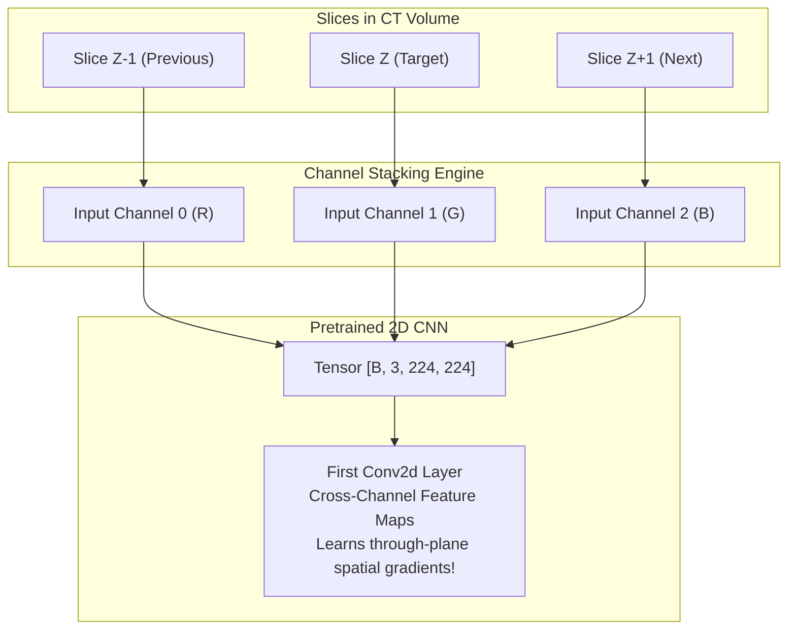

# PulmoVision — Research & Engineering Methodology

This document outlines the end-to-end scientific and engineering methodology guiding PulmoVision Stage 1.

---

## 1. The 2.5D Modelling Paradigm

Standard computer vision treats images as independent 2D projections. In clinical thoracic radiology, a lesion (e.g. peripheral ground-glass opacity) has physical 3D depth and traverses multiple consecutive axial cross-sections.



### Why 2.5D Outperforms Naive 2D and 3D:
1. **Volumetric Context without 3D Compute Overhead:** 3D CNNs require cubic convolutions ($K \times K \times K$) and massive GPU memory, preventing fast iteration. 2.5D leverages standard 2D convolutions while incorporating local $Z$-axis depth.
2. **Transfer Learning Reusability:** 3D pretrained weights are scarce and domain-specific. 2.5D allows direct reuse of ImageNet weights.

---

## 2. Zero-Leakage Patient Partitioning Protocol

```
                        All 377 Patients in COVID-CTset
                                      │
              ┌───────────────────────┴───────────────────────┐
              ▼                                               ▼
   Development Set (train1.csv, 122 pts)           Held-out Test (test1.csv, 255 pts)
   (3,736 slices: 77 Pos / 45 Neg)                 (8,322 slices: 18 Pos / 237 Neg)
              │                                               │
     Stratified Split (Seed 42)                               │ [FROZEN & UNTOUCHED]
      ┌───────┴───────┐                                       │ Never used for early stopping
      ▼               ▼                                       ▼
  Train Set        Val Set                                Final Evaluation Only
 (98 Patients)  (24 Patients)
  2,959 slices    777 slices
  (62 Pos/36 Neg)(15 Pos/9 Neg)
```

### Why Random Slice Splitting Fails in Medical AI:
If slices from Patient A are randomly divided across train and test sets, the model learns the patient's idiosyncratic anatomy (bone morphology, heart size, scanner noise) rather than true pathology. This produces artificially inflated accuracy ($>98\%$) that collapses on new patients. PulmoVision enforces strict **patient-level partitioning**.

### Train/Validation/Test Boundary Safeguards:
- Train/Val split is derived exclusively from `train1.csv` using deterministic patient stratification (seed 42).
- Zero patient overlap: $\text{Train} \cap \text{Val} = \emptyset$, $\text{Train} \cap \text{Test} = \emptyset$, $\text{Val} \cap \text{Test} = \emptyset$.
- `test1.csv` is never accessed by `train.py` or validation loops. Automated assertion `validate_split_integrity()` blocks execution if test patient IDs appear in training or validation manifests.

---

## 3. Radiodensity Windowing Mechanics

Medical CT detectors record X-ray attenuation in Hounsfield Units (HU). In COVID-CTset, values are shifted positive into 16-bit integers $[0, \approx 2200]$.

To isolate pulmonary parenchyma, we apply domain-specific clipping:

$$I_{\text{windowed}} = \text{clip}(I_{\text{raw}}, W_{\text{min}}=200, W_{\text{max}}=1800)$$

$$I_{\text{normalized}} = \frac{I_{\text{windowed}} - W_{\text{min}}}{W_{\text{max}} - W_{\text{min}}}$$

| Tissue Type | Radiodensity (HU) | Shifted 16-bit Representation | Visual Effect in Lung Window |
|---|---|---|---|
| **Air (External & Trachea)** | $-1000\text{ HU}$ | $< 200$ | Clipped to $0.0$ (Pure Black) |
| **Normal Lung Parenchyma** | $-700\text{ to } -500\text{ HU}$ | $300 - 800$ | Grayscale contrast showing vessel trees |
| **Ground-Glass Opacities** | $-400\text{ to } -100\text{ HU}$ | $900 - 1400$ | Bright hazy pulmonary infiltrates |
| **Ribs & Spine (Cortical Bone)** | $+700\text{ to } +1500\text{ HU}$ | $> 1800$ | Clipped to $1.0$ (Saturated White) |

---

## 4. Patient-Level vs Slice-Level Evaluation Protocol

Medical decision-making occurs per patient/scan, not per isolated axial image slice. Because CT scans contain variable slice counts (from tens to hundreds of slices per patient), computing metrics strictly over pooled slices introduces severe evaluation bias:
1. **Slice-count bias:** A single patient with 150 normal slices dominates a patient with 20 slices displaying small focal opacities.
2. **Clinical diagnostic disconnect:** A patient is clinically positive if pathognomonic lesions are present in a meaningful portion of the scan volume, even if the majority of apical and basal slices appear clear.

### Aggregation Strategies:
PulmoVision's evaluation suite (`src/evaluation/metrics.py`) provides:
- **`positive_slice_ratio` (Default):** Calculates the fraction of slices predicted positive $\frac{N_{\text{pos}}}{N_{\text{total}}}$. The patient is classified positive if this ratio exceeds an empirical threshold $\tau$ (e.g. $\tau \ge 0.20$).
- **`mean_prob`:** Averages the positive class probabilities across all slices for a patient: $\bar{p} = \frac{1}{N} \sum_{i=1}^N p_i$. The patient is positive if $\bar{p} \ge \theta_{\text{prob}}$.
- **`majority_vote`:** Patient is positive if $> 50\%$ of slices are predicted positive.

### Rule of Unweighted Patient Evaluation:
Patient-level metrics assign an equal weight of $1.0$ to every patient regardless of slice count:
$$N_{\text{patients}} = \sum_{p \in \mathcal{P}} 1$$
Thresholds $\tau$ must be tuned strictly on the validation partition (`val_split.csv`) and permanently frozen before running inference on the held-out test partition (`test1.csv`).


