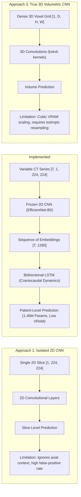
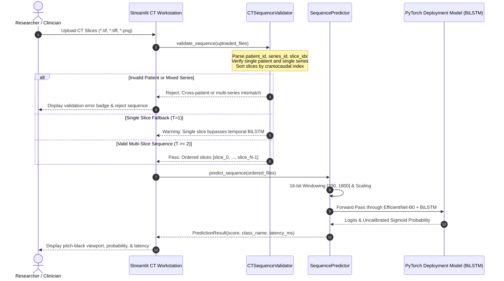
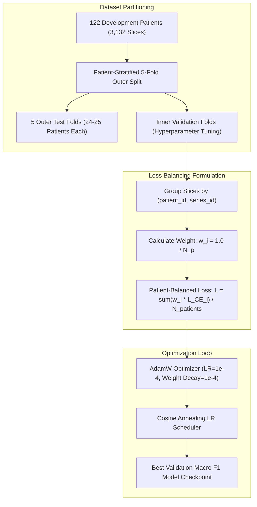

# PulmoVision — Project Architecture Diagrams

This document provides formal architectural diagrams detailing the dataflow, deep learning sequence modeling, inference validation, and user interface modules of the PulmoVision platform.

---

## 1. End-to-End System & Data Flow Architecture

The end-to-end dataflow moves from raw 16-bit thoracic CT slices through deduplication, feature extraction, sequence modeling, cross-validation, and deployment serving:

```mermaid
flowchart TD
    subgraph Data Acquisition & Preprocessing
        A1["Raw 16-bit TIFF Slices (512x512)"] --> A2["Radiodensity Windowing [200, 1800] HU"]
        A2 --> A3["Dynamic Range Scaling [0.0, 1.0]"]
        A3 --> A4["Bilinear Spatial Resizing (224x224)"]
    end

    subgraph Deduplication & Patient Splitting
        A4 --> B1["Forensic SHA-256 Hashing"]
        B1 --> B2["Deduplication Engine (604 Duplicates Resolved)"]
        B2 --> B3["3,132 Canonical Slices (122 Patients, 239 Series)"]
        B3 --> B4["Patient-Stratified Split (Zero Patient Leakage)"]
    end

    subgraph Feature Extraction Pipeline
        B4 --> C1["ImageNet-Pretrained EfficientNet-B0"]
        C1 --> C2["Extract Stage-8 Latent Vectors (1,280-dim)"]
        C2 --> C3["Cached Tensor Embeddings (.pt / .npz)"]
    end

    subgraph Deep Sequence Modeling (Stage 2)
        C3 --> D1["Collate Variable-Length Series [B, T, 1280]"]
        D1 --> D2["Bidirectional LSTM (256-d Hidden, 2 Layers)"]
        D2 --> D3["Temporal Aggregator (Global Mean / Attention)"]
        D3 --> D4["Binary Classification Head (Dropout 0.4 + Linear)"]
    end

    subgraph Inference & Research Workstation
        D4 --> E1["Frozen Deployment Model Checkpoint (0bd81731...)"]
        E1 --> E2["CT Sequence Predictor Service"]
        E3["Real TIFF Series Upload"] --> E4["CT Sequence Validator (Craniocaudal Order)"]
        E4 --> E2
        E2 --> E5["7-View Streamlit Research Workstation"]
    end
```

---

## 2. Structural Paradigm Comparison: 2D vs. 2.5D vs. 3D

This diagram illustrates why the 2.5D sequence modeling architecture achieves optimal memory-accuracy trade-offs for thoracic CT scans:



---

## 3. Stage 2 Sequence Model Architecture Benchmark

Stage 2 systematically evaluated three topological configurations sharing an identical frozen EfficientNet-B0 feature extractor:

```mermaid
flowchart TD
    Input["Input Sequence Slices: [B, T, 1280]"] --> Backbone["EfficientNet-B0 Feature Embeddings"]

    subgraph Experiment A: Atemporal Baseline (82.1K Params)
        Backbone --> A_Pool["Global Arithmetic Mean Pooling across T"]
        A_Pool --> A_Dense["Linear Classifier [1280 -> 64 -> 1]"]
        A_Dense --> A_Out["Sigmoid Score (F1: 0.8236, 17 FNs)"]
    end

    subgraph Experiment B: BiLSTM + Mean Pooling [Leader] (1.46M Params)
        Backbone --> B_LSTM["Bidirectional LSTM (2 Layers, Hidden=256, Bi=512)"]
        B_LSTM --> B_Pool["Global Mean Pooling across Temporal Dim"]
        B_Pool --> B_Head["Classification Head (Dropout 0.4 + Linear [512 -> 1])"]
        B_Head --> B_Out["Sigmoid Score (F1: 0.9461, ROC-AUC: 0.9688, 1 FN)"]
    end

    subgraph Experiment C: BiLSTM + Additive Attention (1.46M Params)
        Backbone --> C_LSTM["Bidirectional LSTM (2 Layers, Hidden=256, Bi=512)"]
        C_LSTM --> C_Attn["Additive Attention Layer: score = v * tanh(W*h + b)"]
        C_Attn --> C_Ctx["Context Vector = sum(alpha_t * h_t)"]
        C_Ctx --> C_Head["Classification Head (Dropout 0.4 + Linear [512 -> 1])"]
        C_Head --> C_Out["Sigmoid Score (F1: 0.9211, ROC-AUC: 0.9466, 5 FNs)"]
    end
```

---

## 4. Sequence Validation & Inference Pipeline

The runtime validation engine guarantees physiological integrity before CT slices enter the deep sequence model:



---

## 5. Streamlit Modular Workstation Component Hierarchy

The application follows an enterprise modular layout separating UI presentation from research data services:

```mermaid
flowchart TD
    App["app/streamlit_app.py (State & Router)"]

    subgraph Styles & Tokens ["app/styles/"]
        Tokens["tokens.py (Semantic Palettes & Radii)"]
        Theme["theme.py (Clinical Dark & Laboratory Light)"]
    end

    subgraph Navigation & Shell ["app/components/"]
        Nav["navigation.py (Material Symbols Icons)"]
        Hdr["header.py (Research Prototype Disclaimer & SVGs)"]
        Cards["metric_cards.py (KPI Indicators)"]
        Charts["charts.py (Plotly ROC, PR, & Distributions)"]
        Viewer["ct_viewer.py (Pitch-Black Viewport #000000)"]
    end

    subgraph View Destinations ["app/views/"]
        V1["overview_view.py"]
        V2["dataset_view.py (ManifestAdapter)"]
        V3["models_view.py (3D vs 2.5D Inspector)"]
        V4["analytics_view.py (CV Benchmarks)"]
        V5["workstation_view.py (TIFF Inference)"]
        V6["explainability_view.py (Grad-CAM)"]
        V7["documentation_view.py (Report Reader)"]
    end

    App --> Styles & Tokens
    App --> Navigation & Shell
    App --> View Destinations
```

---

## 6. Patient-Balanced Training & Nested Cross-Validation

To prevent loss gradients from being dominated by patients with 70 slices over patients with 5 slices, training utilizes equal patient weighting:


