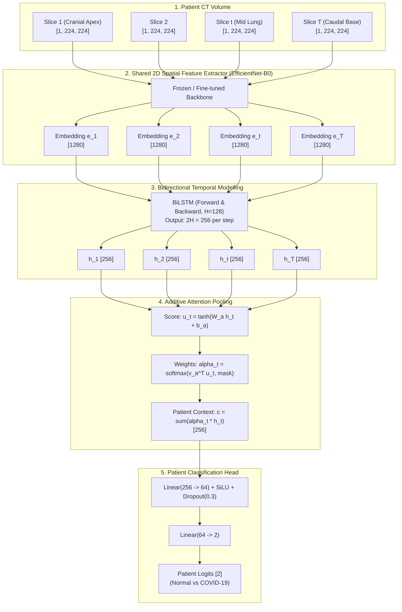

# PulmoVision — Stage 2 Architecture Design: CNN-BiLSTM

**Document:** `docs/research/cnn_bilstm_architecture.md`  
**Status:** Proposal / Pre-Implementation Review  
**Author:** PulmoVision Research Team  
**Hardware Target:** Apple Silicon Metal Performance Shaders (MPS) / M1 Unified Memory  

---

## 1. Research Objective & Theoretical Rationale

### The Limitation of 2D and 2.5D Baselines
In Stage 1, we established that contiguous 2.5D multi-slice stacking ($[S_{z-1}, S_z, S_{z+1}]$) outperformed isolated 2D CNNs by reducing false positive slices by $72.1\%$. However, both 2D and 2.5D models evaluate CT slices as independent, unordered instances. Patient-level predictions were derived using a post-hoc heuristic threshold ($\tau \in [0.20, 0.45]$) on the proportion of positive slices.

**Clinical Reality of Chest CT:**
1. **Volumetric Continuity:** A chest CT is not an arbitrary bag of slices; it is an ordered craniocaudal anatomical volume (apices to lung bases).
2. **Longitudinal Trajectory:** COVID-19 ground-glass opacities (GGO) and consolidations typically show peripheral, posterior, and lower-zone predilection. A model that knows *where* lesions appear in the apical-to-basal sequence possesses clinical context that isolated slices cannot provide.
3. **End-to-End Patient Optimization:** Instead of tuning a post-hoc threshold $\tau$ on isolated slice scores, a sequence model trains the network end-to-end to output a single calibrated patient-level probability $P(\text{COVID} \mid \mathbf{X}_{\text{patient}})$.

### The CNN-BiLSTM Hypothesis
By coupling a pretrained **EfficientNet-B0** spatial feature extractor with a **Bidirectional Long Short-Term Memory (BiLSTM)** network and an **Additive Attention Pooling** mechanism, PulmoVision can capture both forward (cranial $\to$ caudal) and backward (caudal $\to$ cranial) pathological context, yielding superior patient-level discrimination with fewer false positives on uninfected lung volumes.

---

## 2. High-Level Architecture Overview

---

## 3. Detailed Component Specifications & Tensor Geometry

### Component 1: Spatial Feature Extractor (EfficientNet-B0)
- **Input:** Single CT slice tensor $\mathbf{x}_t \in \mathbb{R}^{B \times C \times 224 \times 224}$, where $C=1$ (2D single slice) or $C=3$ (2.5D triplet).
- **Head Truncation:** We strip the original classification layers (`classifier[0]` Dropout and `classifier[1]` Linear(1280, 1000)).
- **Feature Extraction Path:**
  $$\mathbf{F}_t = \text{features}(\mathbf{x}_t) \in \mathbb{R}^{B \times 1280 \times 7 \times 7}$$
  $$\mathbf{e}_t = \text{AdaptiveAvgPool2d}(1)(\mathbf{F}_t) = \text{flatten}(\dots) \in \mathbb{R}^{B \times 1280}$$
- **Embedding Dimension:** Each CT slice is compressed into a 1D vector of dimension $D = 1280$.

---

### Component 2: Patient-Level Sequence Assembly & Craniocaudal Ordering
- **Ordering Guarantee:** In COVID-CTset, slice filenames follow `<label>_patient<ID>_SR_<series>_IM<slice_num>.tif`.
  The slice index `slice_num` directly reflects the axial table position $z$. Slices are sorted strictly in ascending numeric order:
  $$\text{Index Order: } 1, 2, \dots, T_i \implies \text{Cranial (apices) to Caudal (bases)}$$
- **Sequence Representation:** For patient $i$ with $T_i$ slices:
  $$\mathbf{E}_i = [\mathbf{e}_{i, 1}, \mathbf{e}_{i, 2}, \dots, \mathbf{e}_{i, T_i}]^\top \in \mathbb{R}^{T_i \times 1280}$$
- **Empirical Sequence Length Distribution (COVID-CTset):**
  - Minimum: $1$ slice (e.g., `patient11` outlier)
  - 25th Percentile: $11.0$ slices
  - Median: $26.0$ slices
  - Mean: $30.6$ slices
  - 75th Percentile: $46.2$ slices
  - Maximum: $84.0$ slices

---

### Component 3: Variable-Length Batching, Padding & Masking
Because $T_i$ varies from $1$ to $84$, batching multiple patients ($B > 1$) requires zero-padding to the maximum sequence length in that batch $T_{\max} = \max_{b \in [1, B]} T_b$:

- **Padded Batch Tensor:** $\mathbf{X}_{\text{batch}} \in \mathbb{R}^{B \times T_{\max} \times 1280}$.
- **Lengths Vector:** $\mathbf{L} = [T_1, T_2, \dots, T_B] \in \mathbb{Z}^B$.
- **Boolean Padding Mask:** $\mathbf{M} \in \{0, 1\}^{B \times T_{\max}}$, where:
  $$M_{b, t} = \begin{cases} 1 & \text{if } t \le T_b \text{ (valid anatomical slice)} \\ 0 & \text{if } t > T_b \text{ (zero-padded padding)} \end{cases}$$
- **Packed Sequences:** In PyTorch, we wrap padded batches with `torch.nn.utils.rnn.pack_padded_sequence(..., lengths=L, batch_first=True, enforce_sorted=False)` to prevent recurrent operations over padded steps.

---

### Component 4: Bidirectional LSTM Sequence Encoder
- **Why Bidirectional?**
  Pathology in the middle lung fields relies on comparison with healthy lung tissue both above (cranial apices) and below (diaphragmatic bases).
- **Hyperparameters:**
  - `input_size`: $1280$
  - `hidden_size` ($H$): $128$ per direction
  - `num_layers`: $1$ (or $2$ with dropout $0.2$)
  - `bidirectional`: `True`
  - `batch_first`: `True`
- **Output Tensor:**
  $$\mathbf{H} = [\mathbf{h}_1, \dots, \mathbf{h}_{T_i}] \in \mathbb{R}^{B \times T_{\max} \times 2H} = \mathbb{R}^{B \times T_{\max} \times 256}$$
  where $\mathbf{h}_t = [\overrightarrow{\mathbf{h}}_t \,\|\, \overleftarrow{\mathbf{h}}_t] \in \mathbb{R}^{256}$.

---

### Component 5: Sequence Aggregation (Additive Attention vs. Baselines)

#### A. The Pitfall of Mean and Max Pooling
- **Mean Pooling:** $\mathbf{c} = \frac{1}{T_i} \sum_{t=1}^{T_i} \mathbf{h}_t$. Dilutes focal lesions when only 4 out of 40 slices show consolidation.
- **Max Pooling:** $\mathbf{c} = \max_t \mathbf{h}_t$. Overly susceptible to single-slice artifacts.

#### B. Additive Self-Attention Pooling (Bahdanau / Ilse et al.)
We introduce a trainable projection that computes an attention score for each axial level:
1. **Projection:**
   $$\mathbf{u}_t = \tanh(\mathbf{W}_a \mathbf{h}_t + \mathbf{b}_a) \in \mathbb{R}^{B \times T_{\max} \times d_a}$$
   where $\mathbf{W}_a \in \mathbb{R}^{d_a \times 2H}$ with $d_a = 64$.
2. **Scalar Energy Score:**
   $$e_t = \mathbf{v}_a^\top \mathbf{u}_t \in \mathbb{R}^{B \times T_{\max} \times 1}$$
3. **Masked Softmax Normalization:**
   $$\alpha_t = \frac{\exp(e_t) \cdot M_t}{\sum_{j=1}^{T_i} \exp(e_j) + \epsilon} \in [0, 1]$$
   *(Positions where $M_t = 0$ are masked with $-\infty$ prior to softmax so $\alpha_t \equiv 0$ for padded tokens).*
4. **Context Vector (Patient Embedding):**
   $$\mathbf{c}_i = \sum_{t=1}^{T_i} \alpha_t \mathbf{h}_t \in \mathbb{R}^{B \times 256}$$

#### Clinical Explainability Bonus of Attention:
The attention weights $\boldsymbol{\alpha} = [\alpha_1, \dots, \alpha_{T_i}]$ provide **direct, quantitative slice attribution**. We can plot $\alpha_t$ against slice index $z$ to immediately display which anatomical scan depths drove the diagnosis, without requiring Grad-CAM gradient backpropagation.

---

### Component 6: Patient-Level Classification Head
- **Input:** Aggregated patient context vector $\mathbf{c}_i \in \mathbb{R}^{B \times 256}$.
- **MLP Architecture:**
  $$\mathbf{z}_1 = \text{SiLU}(\mathbf{W}_1 \mathbf{c}_i + \mathbf{b}_1) \in \mathbb{R}^{B \times 64}$$
  $$\mathbf{z}_2 = \text{Dropout}(p=0.3)(\mathbf{z}_1)$$
  $$\text{Logits } \mathbf{y} = \mathbf{W}_2 \mathbf{z}_2 + \mathbf{b}_2 \in \mathbb{R}^{B \times 2}$$
- **Loss Function:** Class-weighted CrossEntropyLoss on patient labels:
  $$\mathcal{L} = -\sum_{c \in \{0, 1\}} w_c \cdot y_{i, c} \cdot \log(\text{softmax}(\mathbf{y})_c)$$

---

## 4. End-to-End Tensor Shape Trace

| Step | Operation / Layer | Input Shape | Output Shape | Notes |
| :---: | :--- | :--- | :--- | :--- |
| **1** | Batch CT Slices | — | $[B, T_{\max}, 1, 224, 224]$ | $B$ patients, max $T_{\max}$ slices |
| **2** | Flatten to 2D Batch | $[B, T_{\max}, 1, 224, 224]$ | $[(B \cdot T_{\max}), 1, 224, 224]$ | Required for standard 2D CNN call |
| **3** | EfficientNet Features | $[(B \cdot T_{\max}), 1, 224, 224]$ | $[(B \cdot T_{\max}), 1280, 7, 7]$ | Spatial feature maps |
| **4** | Global Avg Pooling | $[(B \cdot T_{\max}), 1280, 7, 7]$ | $[(B \cdot T_{\max}), 1280]$ | Slice feature embeddings |
| **5** | Reshape to Sequence | $[(B \cdot T_{\max}), 1280]$ | $[B, T_{\max}, 1280]$ | Restores temporal dimension |
| **6** | BiLSTM Layer | $[B, T_{\max}, 1280]$ | $[B, T_{\max}, 256]$ | Forward + backward hidden states |
| **7** | Attention Scoring | $[B, T_{\max}, 256]$ | $[B, T_{\max}, 1]$ | Normalized slice weights $\alpha_t$ |
| **8** | Weighted Pooling | $[B, T_{\max}, 256] \times [B, T_{\max}, 1]$ | $[B, 256]$ | Patient context vector $\mathbf{c}$ |
| **9** | MLP Hidden Layer | $[B, 256]$ | $[B, 64]$ | SiLU activation + Dropout(0.3) |
| **10**| Linear Classifier | $[B, 64]$ | $[B, 2]$ | Final patient class logits |

---

## 5. Memory & Compute Constraints on Apple Silicon MPS

### The End-to-End Memory Bottleneck
If we perform joint end-to-end backpropagation through both EfficientNet-B0 and the BiLSTM with a patient batch size $B=4$ and average sequence length $T=32$:
- Effective slice batch size: $B \cdot T = 4 \times 32 = 128$ slices per gradient step.
- At $224 \times 224$ float32 resolution, maintaining activations for 128 images through EfficientNet-B0 consumes $\approx 1.8\text{ GB}$ of VRAM. While feasible on an 8GB/16GB unified memory M1 Mac, training is slow ($\approx 45\text{ minutes/epoch}$).

### Staged Training Strategy (Recommended)

To ensure rapid experimentation and robust cross-validation without memory paging:

1. **Stage 2.1 — Feature Cache Mode (Frozen Backbone):**
   - Use the best-performing Stage 1 checkpoint (`reports/experiments/exp4_efficientnet_b0_25d/best_checkpoint.pth` or 2D adapted backbone) to pre-extract embeddings for all $12,058$ slices.
   - Cache size on disk: $12,058 \times 1280 \times 4\text{ bytes} \approx 61.7\text{ MB}$.
   - Training the BiLSTM + Attention head on cached features runs at **$>100\text{ epochs/minute}$** on MPS, enabling comprehensive 5-fold cross-validation in under 3 minutes!
2. **Stage 2.2 — End-to-End Fine-Tuning (Post-Architecture Selection):**
   - Once optimal BiLSTM depth, hidden size, and attention parameters are established on cached features, unfreeze the top convolutional stages of EfficientNet-B0 (`features[7:]`) with a low learning rate ($1\times 10^{-5}$) using patient batch size $B=1$ or $B=2$ and gradient accumulation ($4$ steps).

---

## 6. Comparison with Prior Baselines

| Dimension | Stage 1 2D Baselines | Stage 1 2.5D Baselines | Proposed Stage 2 CNN-BiLSTM |
| :--- | :---: | :---: | :---: |
| **Input Unit** | Single slice $[1, H, W]$ | 3 contiguous slices $[3, H, W]$ | Full scan sequence $[T, C, H, W]$ |
| **Spatial Context** | Intra-slice only | Local through-plane ($z \pm 1$) | Local through-plane + Global craniocaudal |
| **Sequence Memory** | None (Markovian) | None | Full recurrence (forward & backward) |
| **Patient Decision** | Heuristic threshold $\tau$ on slice counts | Heuristic threshold $\tau$ on slice counts | End-to-end learned sequence attention |
| **Explainability** | Slice-level Grad-CAM | Slice-level Grad-CAM | **Anatomical depth attention curve + Grad-CAM** |
| **Parameter Scale** | $23.5\text{M}$ (ResNet) / $93\text{K}$ (Custom) | $4.01\text{M}$ (EfficientNet) | **$4.01\text{M} (\text{CNN}) + 1.48\text{M} (\text{LSTM/Attn}) = 5.49\text{M}$** |

---
*Reviewed and documented for developer confirmation prior to code generation.*
