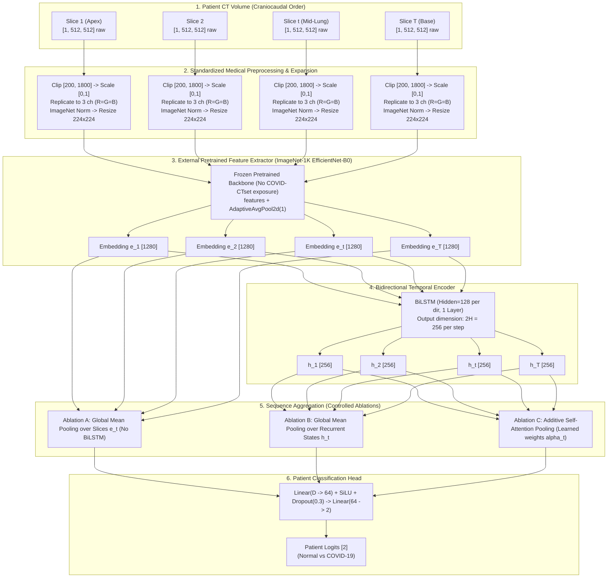

# PulmoVision — Stage 2 Architecture Design: CNN-BiLSTM

**Document:** `docs/research/cnn_bilstm_architecture.md`  
**Status:** Approved Architecture Specification (Pre-Implementation Review)  
**Author:** PulmoVision Research Team  
**Hardware Target:** Apple Silicon Metal Performance Shaders (MPS) / M1 Unified Memory  

---

## 1. Research Objective & Theoretical Rationale

### The Limitation of Stage 1 Slice-Level Heuristics
In Stage 1, 2D and 2.5D CNN baselines classified individual CT slices as isolated, independent instances. Patient-level predictions were derived using a post-hoc heuristic threshold ($\tau \in [0.20, 0.45]$) on the proportion of positive slices.

**Clinical & Anatomical Reality of Chest CT:**
1. **Volumetric Craniocaudal Continuity:** A chest CT is an anatomically ordered sequence of axial cross-sections acquired continuously along the z-axis from cranial lung apices to caudal diaphragmatic bases.
2. **Longitudinal Pathological Distribution:** Viral pneumonias (including COVID-19) exhibit characteristic spatial distributions (predominantly peripheral, posterior, and lower-zone predilection). A sequence model captures relative anatomical lesion location within the scan volume.
3. **End-to-End Patient-Level Optimization:** Rather than tuning a heuristic threshold $\tau$ on isolated slice scores, a sequence model trains end-to-end to output a calibrated patient-level probability $P(\text{COVID-19} \mid \mathbf{X}_{\text{patient}})$.

---

## 2. High-Level Architecture Overview

---

## 3. Preprocessing, Calibration & Input Compatibility

### A. Raw Pixel Value Semantics & Radiodensity Verification
- **Pixel Value Meaning:** The COVID-CTset images are stored as uncompressed 16-bit TIFF grayscale files with raw integer values up to $\approx 2204$. Because the dataset authors did not distribute the accompanying DICOM header files containing rescale slope and rescale intercept parameters, **these pixel values represent raw uncalibrated CT attenuation numbers, NOT certified physical Hounsfield Units (HU)**. 
- **Integrity Rule:** In all documentation and code, pixel intensities are designated as *radiodensity counts*, preserving medical documentation integrity without unsubstantiated diagnostic claims.

### B. Standardized Image Preprocessing Pipeline
1. **Windowing / Intensity Clipping:** Raw 16-bit values are clipped to the empirical lung window:
   $$I_{\text{clipped}} = \text{clip}(I_{\text{raw}}, 200, 1800)$$
2. **Min-Max Dynamic Range Scaling:** Clipped values are scaled to the unit interval $[0.0, 1.0]$:
   $$I_{\text{norm}} = \frac{I_{\text{clipped}} - 200}{1800 - 200}$$
3. **Channel Expansion via Replication:** Standard pretrained torchvision backbones expect 3-channel input ($C=3$). We replicate the grayscale channel across all three color channels without modifying the first convolution layer:
   $$[B, T, 1, 224, 224] \longrightarrow [B \cdot T, 3, 224, 224] \quad \text{where } R = G = B = I_{\text{norm}}$$
4. **Standard ImageNet Normalization:** To match the input distribution expected by the pretrained ImageNet weights:
   $$\mu = [0.485, 0.456, 0.406], \quad \sigma = [0.229, 0.224, 0.225]$$
   $$I_{\text{standardized}, c} = \frac{I_{\text{norm}, c} - \mu_c}{\sigma_c} \quad \text{for } c \in \{0, 1, 2\}$$
5. **Spatial Resampling & Aspect Ratio Preservation:** Slices are resized to $224 \times 224$ using bilinear interpolation (`align_corners=False`). Because native CT slices are square ($512 \times 512$), downsampling to $224 \times 224$ preserves an exact $1:1$ aspect ratio without geometric distortion or padding artifacts.

---

## 4. Feature Extraction & Leakage Prevention Audit

### A. Audit of Stage 1 Checkpoint (`exp4_efficientnet_b0_25d`)
- In Stage 1, `exp4` was trained on `train_split.csv` ($98$ patients: $62$ COVID, $36$ Normal) and checkpointed against `val_split.csv` ($24$ patients).
- If `exp4`'s weights were used to extract features for a 5-fold cross-validation on the 122 development patients, **data leakage would occur**: 80% of the validation patients in any fold were seen by `exp4` during Stage 1 training.

### B. Zero-Leakage Backbone Protocol
1. **Backbone Source:** Official torchvision `efficientnet_b0(weights=EfficientNet_B0_Weights.IMAGENET1K_V1)`.
2. **Zero In-Domain Exposure:** This backbone has **never been trained, fine-tuned, or exposed to any COVID-CTset image**.
3. **Feature Dimension:** Classification head (`classifier[0]` Dropout and `classifier[1]` Linear) is discarded. Spatial feature maps $[1280, 7, 7]$ are pooled via `AdaptiveAvgPool2d(1)` into a fixed 1D embedding vector:
   $$\mathbf{e}_t \in \mathbb{R}^{1280}$$
4. **Deterministic Feature Caching (Option 1):** Pre-extract and cache $1280\text{D}$ vectors for all 3,736 development slices once on disk ($\approx 19.1\text{ MB}$).
5. **Methodological Limitation of Frozen Cache:** In this initial stage, spatial slice augmentations (e.g., slight affine rotations) are omitted. Regularization relies entirely on sequence-level dropout, recurrent dropout, and weight decay.

---

## 5. Sequence Construction, Craniocaudal Ordering & Edge Cases

### A. Anatomical Craniocaudal Ordering
- Filenames follow `<prefix>_patient<ID>_SR_<series>_IM<slice_num>.tif`.
- Slices are sorted strictly in ascending numeric order of `slice_num` (`IM00001` $\to$ `IM00084`), guaranteeing invariant craniocaudal progression from cranial apices to caudal diaphragmatic bases.

### B. Variable-Length Batching & Attention Masking
- Patients have variable slice counts ($T_i \in [1, 84]$).
- Sequences in batch $B$ are zero-padded to $T_{\max} = \max_b T_b$, yielding batch tensor $\mathbf{X} \in \mathbb{R}^{B \times T_{\max} \times 1280}$.
- A boolean mask $M \in \{0, 1\}^{B \times T_{\max}}$ records valid slices ($M_{b, t} = 1$ if $t \le T_b$, else $0$).
- `torch.nn.utils.rnn.pack_padded_sequence` bypasses computation over padded steps.

### C. Edge Case: Sequences with $T = 1$ (Single-Slice Scans)
- Single-slice patients (such as `patient11`) **must not be discarded**.
- **BiLSTM Handling:** Single-step recurrence ($T=1$) executes cleanly with initial zero hidden states $\mathbf{h}_0$.
- **Attention Handling:** For $T=1$, the masked softmax across a single valid position trivially outputs attention weight $\alpha_1 = 1.0$, producing context vector $\mathbf{c} = \mathbf{h}_1$.
- **Data Quality Note:** `patient11` is flagged for a separate data-integrity audit regarding why only 1 slice exists in the official archive.

---

## 6. Sequence Aggregation: Ablations & Additive Attention

### Ablation A: Atemporal Global Mean Pooling (No BiLSTM)
$$\mathbf{c}_i = \frac{1}{T_i} \sum_{t=1}^{T_i} \mathbf{e}_{i, t} \in \mathbb{R}^{1280}$$
Aggregates slice embeddings uniformly without temporal recurrence.

### Ablation B: BiLSTM + Global Mean Pooling
$$\mathbf{h}_t = [\overrightarrow{\mathbf{h}}_t \,\|\, \overleftarrow{\mathbf{h}}_t] \in \mathbb{R}^{256}, \quad \mathbf{c}_i = \frac{1}{T_i} \sum_{t=1}^{T_i} \mathbf{h}_{i, t} \in \mathbb{R}^{256}$$
Incorporates bidirectional craniocaudal contextual modeling, aggregated uniformly across axial depth.

### Ablation C: BiLSTM + Additive Self-Attention Pooling
$$\mathbf{u}_t = \tanh(\mathbf{W}_a \mathbf{h}_t + \mathbf{b}_a) \in \mathbb{R}^{64}$$
$$e_t = \mathbf{v}_a^\top \mathbf{u}_t \in \mathbb{R}^1$$
$$\alpha_t = \frac{\exp(e_t) \cdot M_t}{\sum_{j=1}^{T_i} \exp(e_j) + \epsilon} \in [0, 1]$$
$$\mathbf{c}_i = \sum_{t=1}^{T_i} \alpha_t \mathbf{h}_t \in \mathbb{R}^{256}$$

### Epistemic Boundary on Attention Interpretation
> [!WARNING]
> Attention weights $\alpha_1, \dots, \alpha_T$ represent mathematical saliency weights quantifying relative feature contributions to the context vector. **They are NOT verified clinical explanations, surrogate radiologist attention, or evidence of clinical diagnostic reasoning.** They are reported strictly as model-weight diagnostic visualizations.

---

## 7. Patient Classification Head & Tensor Lifecycle

### Classification Head
- **Input:** Context vector $\mathbf{c}_i \in \mathbb{R}^{D_{\text{agg}}}$ ($1280$ for Ablation A; $256$ for Ablations B & C).
- **Architecture:**
  $$\mathbf{z}_1 = \text{SiLU}(\mathbf{W}_1 \mathbf{c}_i + \mathbf{b}_1) \in \mathbb{R}^{64}$$
  $$\mathbf{z}_2 = \text{Dropout}(p=0.3)(\mathbf{z}_1)$$
  $$\text{Logits } \mathbf{y}_i = \mathbf{W}_2 \mathbf{z}_2 + \mathbf{b}_2 \in \mathbb{R}^2$$

### Complete End-to-End Tensor Shape Trace
| Step | Operation | Input Shape | Output Shape | Notes |
| :---: | :--- | :--- | :--- | :--- |
| **1** | Batch CT Scans | — | $[B, T_{\max}, 1, 224, 224]$ | $B$ patients, padded to $T_{\max}$ |
| **2** | Grayscale Expansion | $[B, T_{\max}, 1, 224, 224]$ | $[(B \cdot T_{\max}), 3, 224, 224]$ | $R=G=B$ |
| **3** | ImageNet Norm | $[(B \cdot T_{\max}), 3, 224, 224]$ | $[(B \cdot T_{\max}), 3, 224, 224]$ | Standardized |
| **4** | EfficientNet Features | $[(B \cdot T_{\max}), 3, 224, 224]$ | $[(B \cdot T_{\max}), 1280, 7, 7]$ | Spatial maps |
| **5** | Global Avg Pooling | $[(B \cdot T_{\max}), 1280, 7, 7]$ | $[(B \cdot T_{\max}), 1280]$ | Slice embeddings |
| **6** | Restore Sequence | $[(B \cdot T_{\max}), 1280]$ | $[B, T_{\max}, 1280]$ | Sequence reconstruction |
| **7** | BiLSTM Encoder | $[B, T_{\max}, 1280]$ | $[B, T_{\max}, 256]$ | Recurrent forward + backward |
| **8** | Masked Attention | $[B, T_{\max}, 256]$ | $[B, T_{\max}, 1]$ | Attention weights $\alpha_t$ |
| **9** | Context Pooling | $[B, T_{\max}, 256] \times [B, T_{\max}, 1]$ | $[B, 256]$ | Context vector $\mathbf{c}_i$ |
| **10**| MLP Classifier | $[B, 256]$ | $[B, 2]$ | Normal vs COVID-19 logits |

---

## 8. Compute, Storage & Memory on Apple Silicon MPS

- **Feature Cache Size:** $3,736 \text{ slices} \times 1280 \times 4\text{ bytes} \approx 19.1\text{ MB}$ stored in `data/processed/dev_patient_features_effnet_b0.pt`.
- **Extraction Time:** $\approx 45\text{ seconds}$ once on Apple MPS.
- **Sequence Training Throughput:** $> 150\text{ epochs/minute}$ on cached embeddings with $< 1\text{ MB}$ memory footprint, enabling exhaustive nested cross-validation without memory pressure.
