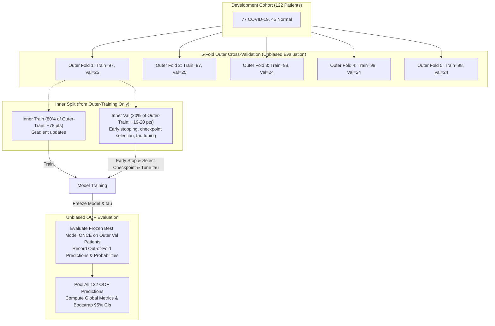

# PulmoVision — Stage 2 Research Protocol & Nested Cross-Validation Plan

**Document:** `docs/research/cnn_bilstm_experiment_protocol.md`  
**Status:** Approved Experimental Protocol (Pre-Implementation Review)  
**Author:** PulmoVision Research Team  
**Dataset Base:** COVID-CTset Development Partition ($122$ patients: $77$ COVID-19, $45$ Normal)  

---

## 1. Research Protocol Objectives

1. Determine whether recurrent bidirectional sequence modeling across ordered axial CT slices provides statistically superior patient-level classification compared with atemporal sequence pooling.
2. Quantify the specific contribution of **Additive Self-Attention Pooling** versus **Global Mean Pooling**.
3. Eliminate feature-extraction data leakage by using an external ImageNet-1K pretrained backbone that has never been exposed to the COVID-CTset development or test cohort.
4. Establish completely unbiased out-of-fold (OOF) performance estimates using a **Nested Patient-Level Cross-Validation** design.
5. Maintain strict quarantine of the official held-out test partition (`test1.csv`).

---

## 2. Decision 1: Deterministic On-Disk Feature Caching

### A. Backbone Specification & Provenance Guarantee
- **Backbone Model:** `torchvision.models.efficientnet_b0(weights=EfficientNet_B0_Weights.IMAGENET1K_V1)`.
- **Pretrained Identifier:** `IMAGENET1K_V1` (PyTorch Hub / torchvision official release).
- **Provenance Verification:** This backbone has **never been trained, fine-tuned, or exposed to any COVID-CTset image**.
- **Prohibition:** The Stage 1 checkpoint (`exp4_efficientnet_b0_25d/best_checkpoint.pth`) **must not be used** for feature extraction because it was trained on 80% of the development patients, which would cause severe feature-extraction leakage in cross-validation.

### B. Caching Strategy
- We extract the $1280$-dimensional embedding vectors for all $3,736$ development slices ($122$ patients) once and persist them to disk at `data/processed/dev_patient_features_effnet_b0.pt`.
- The exact same feature cache is reused across all outer/inner folds and across Experiments A, B, and C.
- **Reproducibility Record:** The extraction script will record:
  - Library versions: `torch`, `torchvision`.
  - Backbone weight identifier and SHA256 parameter checksum.
  - Image preprocessing configuration.
  - Output feature cache file hash (SHA256).

### C. Methodological Limitation of Frozen Feature Caching
- **Omission of Image-Space Augmentations:** Because spatial feature embeddings are extracted once and cached, dynamic spatial augmentations (e.g., slight random affine rotations, scaling) are not applied during sequence training.
- **Regularization Burden:** Regularization is provided strictly by sequence-level dropout ($p=0.3$), recurrent dropout, and optimizer weight decay ($1\times 10^{-4}$). This limitation is accepted to ensure rapid, exact, and leakage-free nested cross-validation.

---

## 3. Decision 2: Input Preprocessing & Normalization Protocol

1. **Pixel Value Semantics:** Raw 16-bit TIFF pixel values range from $0$ to $\approx 2204$. They represent raw CT radiodensity counts without embedded DICOM rescale parameters. They are designated as *radiodensity counts* and **must not be claimed to be physical Hounsfield Units (HU)**.
2. **Intensity Clipping:** Clip raw values to the documented lung window: $[200, 1800]$.
3. **Dynamic Range Scaling:** Linear scaling to $[0.0, 1.0]$: $(I_{\text{clipped}} - 200) / 1600$.
4. **Channel Expansion:** Replicate the single grayscale channel into 3 identical channels ($R=G=B$) to match torchvision backbone expectations: $[B, T, 1, 224, 224] \to [B \cdot T, 3, 224, 224]$.
5. **ImageNet Normalization:** Standardize each channel using ImageNet statistics:
   $$\mu = [0.485, 0.456, 0.406], \quad \sigma = [0.229, 0.224, 0.225]$$
   $$I_{\text{standardized}, c} = \frac{I_{\text{norm}, c} - \mu_c}{\sigma_c}$$
6. **Spatial Resampling & Aspect Ratio:** Bilinear interpolation to $224 \times 224$ (`align_corners=False`). Because native CT scans are square ($512 \times 512$), downsampling preserves an exact isotropic $1:1$ aspect ratio without distortion.
7. **Consistency Rule:** Native $[0, 1]$ normalization is preserved as a future preprocessing ablation. Normalization is held strictly constant across Experiments A, B, and C.

---

## 4. Decision 3: Nested Patient-Level Cross-Validation Design

To guarantee that out-of-fold performance estimates are completely unbiased by hyperparameter selection, early stopping, or threshold tuning, we implement **Nested Cross-Validation** across the $122$ development patients.

### Protocol for Each Outer Fold $k \in \{1, \dots, 5\}$:
1. **Outer Partition:** Outer training set ($\text{Train}_k$, ~97–98 patients) and Outer validation set ($\text{Val}_k$, ~24–25 patients).
2. **Inner Split Creation:** From $\text{Train}_k$ alone, construct an inner stratified validation split ($80\%$ inner-train $\approx 78$ patients; $20\%$ inner-val $\approx 19–20$ patients) using fixed inner seed (`seed=100 + k`).
3. **Inner Optimization Boundary:**
   - Optimize model weights strictly on inner-train batches.
   - Use inner-validation loss and inner-validation Macro F1 for **early stopping** (patience = 5 epochs) and **best checkpoint selection**.
   - Use inner-validation probabilities to select the optimal patient classification threshold $\tau^* \in [0.10, 0.50]$.
4. **Strict Outer Isolation:** Outer-validation patients ($\text{Val}_k$) are **never seen** during training, early stopping, checkpoint selection, or threshold search.
5. **Single Unbiased Outer Evaluation:** Restore the best inner-validation checkpoint, apply the frozen threshold $\tau^*$, and evaluate on $\text{Val}_k$ **exactly once**.
6. **OOF Storage:** Record predicted continuous probabilities and binary labels for all patients in $\text{Val}_k$.

### Complete Cohort Coverage:
After all 5 outer folds complete, every one of the 122 development patients has **exactly one unbiased out-of-fold prediction**.

### Computational Implications:
Nested CV trains $5$ models per experiment ($15$ models total for Experiments A, B, and C). Because feature vectors are pre-cached, each model trains in $\approx 2–5\text{ seconds}$ on Apple Silicon MPS. The entire 15-model nested benchmark completes in **under 2 minutes**.

---

## 5. Controlled Ablation Matrix

All three experiments share **identical outer/inner patient folds, identical cached features, identical preprocessing, and identical evaluation rules**:

| Experiment ID | Architecture Name | Recurrent Encoder | Sequence Aggregation | Trainable Parameters | Ablation Role |
| :--- | :--- | :---: | :--- | :---: | :--- |
| **Experiment A** | `effnet_b0_mean_pooling` | None | Global Mean Pooling over $T$ slices | $\approx 82\text{K}$ (head only) | Atemporal volume baseline |
| **Experiment B** | `effnet_b0_bilstm_mean` | BiLSTM ($H=128$) | Global Mean Pooling over $T$ states | $\approx 1.48\text{M}$ (BiLSTM + head) | Sequence recurrence baseline |
| **Experiment C** | `effnet_b0_bilstm_attention` | BiLSTM ($H=128$) | Additive Self-Attention ($\mathbf{W}_a, \mathbf{v}_a$) | $\approx 1.49\text{M}$ (BiLSTM + attn + head) | Proposed champion candidate |

*Historical Stage 1 heuristic slice-thresholding ($\tau = 0.20$) remains a separate historical benchmark.*

---

## 6. Decision 4: Metrics, Uncertainty & Statistical Standards

### A. Performance Metrics Suite
For each experiment (A, B, C), report:
1. **Patient Macro F1** (Primary selection metric)
2. **ROC-AUC** (Area under ROC curve from continuous predicted probabilities)
3. **PR-AUC** (Precision-Recall AUC / Average Precision)
4. **Balanced Accuracy** ($\frac{\text{Sensitivity} + \text{Specificity}}{2}$)
5. **Sensitivity (Recall)**
6. **Specificity**
7. **Precision**
8. **Accuracy**
9. **Raw Confusion Counts** ($TP, FP, TN, FN$)

### B. Statistical Rigor & Uncertainty Quantification
1. **Per-Fold Metrics:** Tabulate individual metrics for Folds 1 through 5.
2. **Cross-Fold Summary ($\mu \pm \sigma$):** Report fold mean and standard deviation to characterize **descriptive fold-to-fold variability** (partition sensitivity).
3. **Pooled Out-of-Fold (OOF) Metrics:** Concatenate all 122 outer-fold validation predictions into a single unified cohort ($N=122$).
4. **Patient-Level Bootstrap Confidence Intervals (95% CI):**
   - Perform $1,000$ stratified bootstrap resamples of the $122$ pooled patient predictions.
   - Compute empirical $2.5\text{th}$ and $97.5\text{th}$ percentiles for Sensitivity, Specificity, and Macro F1.
5. **Clear Epistemic Distinction:** Fold variability ($\mu \pm \sigma$) must not be conflated with confidence intervals (bootstrap percentiles quantify sampling error of the pooled estimator).

---

## 7. Decision 5: Git Workflow & Branch Strategy

- Following explicit developer approval, all Stage 2 implementation, feature caching, and nested experiments will be conducted on a single dedicated branch:
  $$\mathbf{feature/cnn-bilstm}$$
- **Five-Branch Maximum Preservation:** Before creating `feature/cnn-bilstm`, verify the active branches (`git branch -a`) and archive/remove completed feature branches if necessary to strictly respect the repository's 5-branch maximum.
- **No Branch Proliferation:** No additional sub-branches (e.g. `exp-a`, `exp-b`) will be created.

---

## 8. Strict Pre-Implementation Restrictions

For this stage:
- **No model code implemented.**
- **No features extracted or cached.**
- **No models trained or fine-tuned.**
- **No evaluation on `test1.csv`.**
- **No branches created, and no commits made.**
