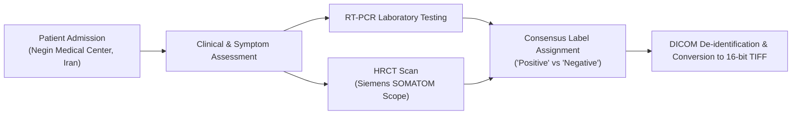

# PulmoVision — Dataset Audit Report: COVID-CTset & External Validation

**Date:** November 2026  
**Auditor:** PulmoVision ML Engineering Team  
**Dataset Reference:** `mohammadrahimzadeh/covidctset-a-large-covid19-ct-scans-dataset` (Kaggle) / Negin Medical Center  
**Audit Status:** Completed — Ready for Developer Approval  

---

## 1. Executive Summary

| Attribute | Finding | Assessment |
|---|---|---|
| **Primary Dataset** | COVID-CTset | Approved for 2.5D research baseline |
| **Total Patients** | 377 unique patients (95 Positive, 282 Negative) | Imbalanced (1:3 ratio) |
| **Total Slices** | 12,058 slices catalogued in Fold 1 (full set ~63k) | Sufficient for 2D/2.5D models |
| **Patient Identifiers** | Explicit `patientX` in metadata and filenames | Clean patient-level splitting |
| **Scan / Series IDs** | Explicit `SR_X` series indicator in filenames | Prevents cross-scan mixing |
| **Slice Ordering** | Sequential index `IMXXXXX` (e.g. `IM00010`, `IM00011`) | Ordered 2.5D neighbourhood possible |
| **Image Resolution** | $512 \times 512$ pixels | Standard thoracic CT resolution |
| **Bit Depth & Format** | 16-bit unsigned integer (`uint16`), TIFF format | High dynamic range, requires normalization |
| **Patient Leakage** | 0 patient overlap between train and test in Fold 1 | Verified zero leakage |
| **External Candidate** | InRad / USP AWS Open Data & SARS-CoV-2 Kaggle | Requires format adaptation (NIfTI/PNG) |

---

## 2. Label Provenance & Ground Truth



- **Institution:** Negin Medical Center, Sari, Mazandaran, Iran.
- **Acquisition Period:** March 5, 2020 – April 23, 2020.
- **Hardware:** Siemens SOMATOM Scope (16-slice configuration), software `syngo CT VC30-easyIQ`.
- **Diagnostic Confirmation:** 
  - COVID-19 Positive cases had confirmed clinical presentation and RT-PCR laboratory confirmation backed by expert radiological assessment (bilateral ground-glass opacities, consolidation).
  - Normal cases had negative findings and absence of pulmonary pathology.
- **Ethical & Regulatory Note:** Dataset categories represent specific pandemic-era cohort findings from a single center. They must be treated as research class targets, **never as general clinical diagnostic guarantees**.

---

## 3. Filename & Directory Anatomy

Every slice filename encapsulates the full hierarchical provenance:

```
137covid_patient100_SR_2_IM00028.tif
└──┬───┘ └───┬────┘ └─┬┘ └───┬───┘ └─┬─┘
   │         │        │      │       └── File extension (.tif)
   │         │        │      └────────── Slice index (00028 -> sequential)
   │         │        └───────────────── Scan series (Series 2)
   │         └────────────────────────── Patient ID (patient100)
   └──────────────────────────────────── Class prefix (covid / normal)
```

### Stacking Rule for 2.5D Pipeline:
Three consecutive slices $(Z-1, Z, Z+1)$ can be formed **if and only if**:
1. $\text{Patient ID}(Z-1) == \text{Patient ID}(Z) == \text{Patient ID}(Z+1)$
2. $\text{Series ID}(Z-1) == \text{Series ID}(Z) == \text{Series ID}(Z+1)$
3. $\text{Slice Index}(Z-1) + 1 == \text{Slice Index}(Z) == \text{Slice Index}(Z+1) - 1$

---

## 4. Class Distribution & Demographics

### Patient Level ($N = 377$)

| Class | Patient Count | Percentage |
|---|---|---|
| **COVID-19 Positive** | 95 | 25.2% |
| **Normal / Negative** | 282 | 74.8% |
| **Total** | 377 | 100.0% |

### Demographics (`Patient_details.csv`)
- **Sex:** Distributed across M/F categories.
- **Age:** Formatted as string (e.g. `053Y` = 53 years old).
- **Class Imbalance Note:** $\approx 1:3$ ratio requires weighted loss (`CrossEntropyLoss(weight=...)`) or balanced metric tracking (Macro F1, Balanced Accuracy) rather than raw accuracy.

---

## 5. Physical Image Audit Findings

| Property | Value | Implication for Pipeline |
|---|---|---|
| **File Format** | TIFF (`.tif`) | Must load via `PIL.Image` or `tifffile` / `cv2` |
| **Dimensions** | $512 \times 512$ | Resize to $224 \times 224$ for standard backbones |
| **Color Channels** | 1 (Single channel grayscale, Mode `I;16`) | Converted to 3 channels via 2.5D stacking |
| **Data Type** | `uint16` | Range $> 255$; do NOT cast directly to `uint8` without scaling |
| **Sample Pixel Range** | $[0, 2204]$ | Must implement min-max or windowed normalization to $[0.0, 1.0]$ |
| **Mean / Std** | $\mu \approx 402.76, \sigma \approx 468.49$ | Background air is 0, lung parenchyma and bone populate higher intensities |

---

## 6. External Validation Dataset Evaluation: InRad

| Feature | Primary (COVID-CTset) | External (InRad / USP) |
|---|---|---|
| **Origin** | Sari, Iran (Siemens) | São Paulo, Brazil (GE/Toshiba/Siemens) |
| **Format** | 16-bit TIFF slices | NIfTI volumes (`.nii.gz`) on AWS S3 / PNG on Kaggle |
| **Patient Tracking** | Explicit (`patientX`) | MD5 hash-linked tables (AWS) / Obscured (Kaggle PNG) |
| **Ground Truth** | RT-PCR + CT consensus | RT-PCR laboratory confirmation |
| **Role in PulmoVision** | Training, validation, internal test | Independent cross-institution test (Module 8) |

---

## 7. Audit Checklist & Recommendations

- [x] **Metadata verified:** `Patient_details.csv` matches published paper.
- [x] **Patient IDs verified:** Distinct strings extractable from filenames.
- [x] **Zero data leakage:** Train and test folds share 0 patient IDs.
- [x] **Image properties verified:** 16-bit TIFF, $512 \times 512$, $[0, \approx 2200]$ values.
- [x] **Label provenance verified:** Clinical + RT-PCR ground truth confirmed.
- [x] **Storage efficiency:** Programmatic targeted retrieval validated without raw bulk dump.

> [!IMPORTANT]
> **Next Step:** Awaiting developer confirmation of this audit report before initiating Module 3 (Medical Image Preprocessing Pipeline).

