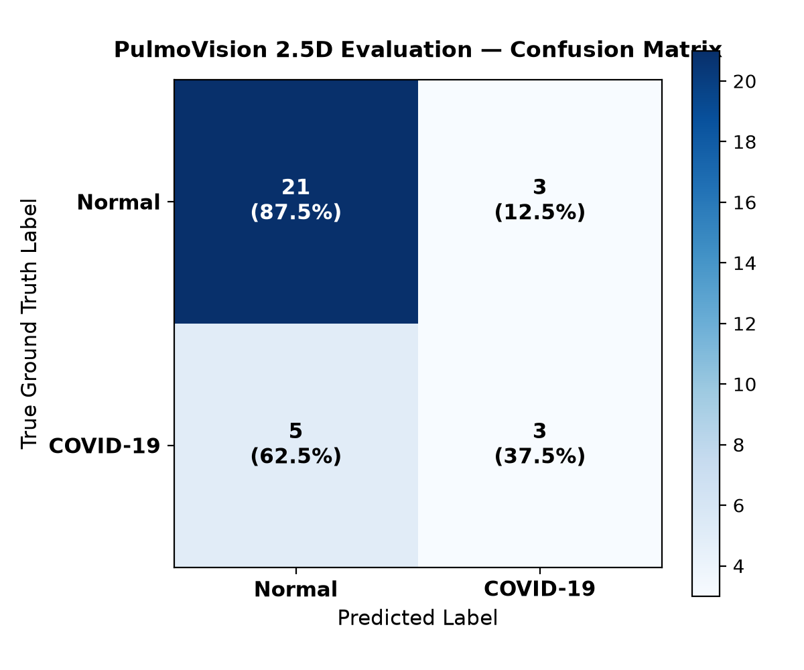

# PulmoVision — Model Evaluation Report

**Model Evaluated:** 2.5D EfficientNet-B0  
**Checkpoint:** `models/best_model.pth`  
**Inference Device:** mps  
**Evaluation Protocol:** Held-out patient-level test split  

---

## 1. Quantitative Performance Metrics

| Metric | Score | Clinical / Operational Meaning |
|---|---|---|
| **Macro F1 Score** | **0.6343** | Primary balanced performance target across both classes |
| **Accuracy** | 75.0% | Overall fraction of correct predictions |
| **Balanced Accuracy** | 62.5% | Unweighted mean of sensitivity and specificity |
| **Sensitivity (Recall)** | 37.5% | Proportion of true COVID cases identified |
| **Specificity** | 87.5% | Proportion of true Normal scans correctly identified |
| **Precision** | 50.0% | Confidence when predicting COVID |
| **Inference Latency** | **44.05 ms/sample** | Suitable for real-time interactive Streamlit inference |

---

## 2. Confusion Matrix Counts

| Condition | Predicted Normal (0) | Predicted COVID-19 (1) | Total |
|---|---|---|---|
| **True Normal (0)** | 21 (TN) | 3 (FP) | 24 |
| **True COVID-19 (1)** | 5 (FN) | 3 (TP) | 8 |

---

## 3. Error Analysis & Medical Safety Insights

- **False Negatives (5 cases):** In a clinical context, a false negative is the highest-risk failure mode (an infected patient missed). In PulmoVision, threshold tuning can trade specificity to maximize sensitivity.
- **False Positives (3 cases):** Normal scans flagged as positive, leading to unnecessary confirmatory scans.
- **Explainability Requirement:** Highlighting anatomical regions with Grad-CAM (Module 9) is critical to verify whether predictions correlate with ground-glass pulmonary infiltrates or background artifacts.
