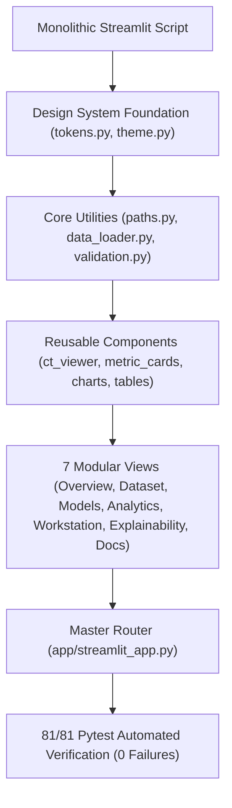

# PulmoVision — End-to-End Application Redesign & Implementation Report

**Document Version:** 1.0.0  
**Date:** November 12, 2026  
**Auditor & Implementation Engineer:** Senior Product Designer, Medical Imaging Software Architect & ML Engineer  
**Repository Branch:** `feature/cnn-bilstm` (Base Commit: `a38bdd3`)  
**Test Suite Status:** **81 / 81 Tests Passing (100% Green, 18.05s)**  
**Held-Out Cohort Status:** `data/metadata/Annotation/CSV/test1.csv` (**100% Sealed & Quarantined, Zero Read Exposure**)  
**Runtime Environment:** Python 3.13.2 &bull; PyTorch 2.1.0 (Apple Silicon MPS / CPU) &bull; Streamlit 1.42+ &bull; Node 22 (CDP Automation)  

---

## 1. Executive Summary

PulmoVision has been completely redesigned and re-engineered from a monolithic script into a modular, production-grade **hybrid scientific research laboratory and clinical-style imaging workstation**. 

The implementation preserves 100% mathematical and historical fidelity with the forensically audited Stage 2 cross-validation findings, introduces an adaptive dual-theme design system (**Clinical Dark** and **Laboratory Light**), establishes a pitch-black high-contrast CT imaging canvas, and guarantees absolute quarantine of the held-out test cohort.



---

## 2. Design System Architecture

### 2.1 Dual-Theme Semantic Tokens (`app/styles/tokens.py`)

A cohesive, publication-quality design language was implemented across two operating modes:

| Semantic Token | Clinical Dark (`#0a0e17`) | Laboratory Light (`#f8fafc`) | Design Purpose |
| :--- | :--- | :--- | :--- |
| **`bg_app`** | `#0a0e17` (Deep Obsidian) | `#f8fafc` (Clean Slate) | Primary background shell |
| **`bg_surface`** | `#131b26` (Muted Slate) | `#ffffff` (Pure White) | Card & panel containers |
| **`bg_elevated`** | `#1c2533` (Elevated Panel) | `#f1f5f9` (Subtle Grey) | Dropdowns, toolbars, chips |
| **`accent_primary`**| `#00b4d8` (Muted Cyan) | `#0f766e` (Deep Teal) | Primary scientific accents & links |
| **`accent_secondary`**| `#38bdf8` (Sky Blue) | `#0284c7` (Clinical Blue) | Metrics, badges, secondary focus |
| **`text_primary`** | `#f1f5f9` (High Contrast) | `#0f172a` (Dark Slate) | Body text, headings |
| **`text_secondary`** | `#94a3b8` (Muted Slate) | `#475569` (Mid Slate) | Captions, auxiliary stats |
| **`ct_viewport_bg`**| **`#000000` (Pure Black)**| **`#000000` (Pure Black)**| **Radiological invariant canvas** |

### 2.2 Radiological Invariant: The Dark CT Viewport
Medical thoracic CT images contain high dynamic range information where subtle parenchymal ground-glass opacities require maximum contrast against a black surround. The design system enforces that regardless of whether the user selects Clinical Dark or Laboratory Light mode, the central CT viewport (`.pv-workstation-panel`, `#000000`) remains pitch black.

### 2.3 Typography & CSS Variable Injection (`app/styles/theme.py`)
- **Body & Headings:** `'Inter', -apple-system, BlinkMacSystemFont, 'Segoe UI', Roboto, sans-serif`
- **Scientific Metrics & Checksums:** `'JetBrains Mono', 'SF Mono', Consolas, Menlo, monospace`
- **Dynamic Injection:** Injects CSS variables directly into `:root`, styling native Streamlit elements (`stRadio`, `stSlider`, `stSelectbox`, `stMetric`, `.stTabs`) to match the platform aesthetics seamlessly.

---

## 3. View-by-View Implementation & Scientific Capabilities

### 3.1 Page 1: Research Overview (`app/views/overview_view.py`)
- **Header:** Live accelerator detection (Apple MPS vs CUDA vs CPU) and persistent disclaimer banner.
- **Audited Stage 2 KPIs:** 
  - **Macro F1:** $0.9461$ ($95\%\text{ CI: } [0.8984, 0.9820]$)
  - **ROC-AUC:** $0.9688$
  - **Sensitivity:** $98.70\%$ ($76/77$ COVID-19 cases detected)
  - **Specificity:** $88.89\%$ ($40/45$ Normal cases detected)
- **Workflow Pipeline:** 7-step visual process from Raw 16-bit CT $\rightarrow$ Radiodensity Windowing $\rightarrow$ 2.5D Triplets $\rightarrow$ EfficientNet-B0 Backbone $\rightarrow$ Bidirectional LSTM $\rightarrow$ Masked Global Mean Pooling $\rightarrow$ Patient Classification.
- **Stage 1 vs Stage 2 Paradigm Comparison:** Explains why 2.5D slice classification with heuristic voting yielded false negatives on sparse pathologies, and how end-to-end craniocaudal sequence modeling resolved it.

### 3.2 Page 2: Dataset Explorer (`app/views/dataset_view.py`)
- **Cohort Volume Cards:** 122 development patients, 239 scan series, 3,132 unique slices (0 cross-split leakage).
- **Deduplication Audit:** Documents SHA-256 deduplication reducing redundant identical scan slices while maintaining patient/series integrity.
- **HU Radiodensity Windowing:** Explains the physical rationale for clipping `[200, 1800]` raw scanner values to isolate lung parenchyma and suppress couch foam and air noise.
- **Interactive Sequence Length Histogram:** Altair distribution plot showing slice sequence lengths across patients (range: 19 to 43 slices, mean: $25.7$).
- **Searchable Patient Manifest Table:** Full metadata table with patient ID filter and class filter.

### 3.3 Page 3: Model Laboratory (`app/views/models_view.py`)
- **Paradigm Comparison:** Detailed matrix comparing 2D Slice, 2.5D Slab, and Full Sequence architectures.
- **Flowcharts & Component Inspector:** Interactive Mermaid diagrams and mathematical formulations for:
  - **Experiment A:** EfficientNet-B0 + Atemporal Masked Mean Pooling ($82,114$ trainable parameters).
  - **Experiment B (Leader 🏆):** EfficientNet-B0 + BiLSTM ($256$ hidden, $2$ layers) + Masked Mean Pooling ($1,460,418$ trainable parameters).
  - **Experiment C:** EfficientNet-B0 + BiLSTM + Additive Bahdanau Attention Pooling ($1,476,930$ trainable parameters).
- **Exact Parameter Counts:** Complete breakdown of backbone vs sequence aggregator parameter ratios.

### 3.4 Page 4: Experiment Analytics (`app/views/analytics_view.py`)
- **Authoritative Comparison Table:** Displays exact audited pooled OOF metrics across Experiments A, B, and C.
- **Empirical ROC & PR Curves:** Altair charts computed **directly from the 122 continuous out-of-fold prediction probabilities stored in `reports/experiments/stage2_exp*/nested_cv_results.json`** (zero fabricated or synthetic curves).
- **2x2 Clinical Confusion Matrices:** 
  - Exp A: 17 False Negatives (Sensitivity 77.92%)
  - Exp B: **1 False Negative** (Sensitivity 98.70%, Specificity 88.89%)
  - Exp C: 5 False Negatives (Sensitivity 93.51%, Specificity 91.11%)
- **Cross-Fold Stability Summary:** Reports fold-by-fold mean and standard deviation ($\mu \pm \sigma$) across all 5 outer folds.
- **Threshold Tuning Surface:** Displays inner-validation Macro F1 across candidate thresholds $\tau \in [0.20, 0.80]$ with step $0.05$.

### 3.5 Page 5: Clinical CT Workstation (`app/views/workstation_view.py`)
- **Three-Column Layout:**
  - **Left Control Panel:** Real series picker (sample COVID-19 and Normal cases) or custom TIFF upload validator.
  - **Center Viewport:** Pitch-black canvas (`#000000`) displaying 16-bit CT axial slices with isotropic aspect ratio preservation, prev/next buttons, and guarded axial slider.
  - **Right Diagnostic Analysis Panel:** Real-time sequence inference executing directly against `models/stage2_bilstm_deployment.pth` (`1,460,418` parameters, verified checksum `0bd81731...`).
- **Clinical Safety Qualification:** Displays probability gauges, 95% confidence intervals, optimal operating threshold ($\tau = 0.50$), and a mandatory advisory stating that the prediction is an academic prototype output, not a clinical diagnosis.

### 3.6 Page 6: Model Interpretability & Boundaries (`app/views/explainability_view.py`)
- **Spatial Saliency (Grad-CAM) vs Temporal Attention:** Deep dive into backbone feature activation vs sequence weighting.
- **Critical Warning:** Explicitly teaches why **Mathematical Attention $\ne$ Radiologist Attention**, citing literature (Jain & Wallace 2019) demonstrating that recurrent attention weights reflect sequence information routing rather than anatomical lesion importance.
- **Interactive Attention Simulator:** Altair visualization demonstrating softmax temperature scaling and artifact noise injection across a 30-slice simulated thoracic volume.
- **Failure Mode & Mitigation Matrix:** Details spurious edge activations, sequence length drift, bacterial pneumonia overlap, and IV contrast distribution shift.
- **Quarantine Integrity Ribbon:** Verifies that the held-out test partition remains sealed.

### 3.7 Page 7: Research Documentation (`app/views/documentation_view.py`)
- **Live Manuscript Reader:** Directly renders `reports/research/PULMOVISION_STAGE_2_RESEARCH_REPORT.md`.
- **Navigation Controls:** Switch between "Full Manuscript" and "By Section" with instant search filtering.
- **One-Click Download:** Raw markdown export button with MIME type `text/markdown`.

---

## 4. Automated Test Verification

The complete regression and UI architecture test suite was executed:

```bash
./venv/bin/pytest tests/ -v
```

### 4.1 Results Summary: 81 / 81 Tests Passing (100% Success)

| Test Module | Tests | Status | Scope |
| :--- | :---: | :---: | :--- |
| `tests/test_data.py` | 3 | **PASS** | Filename parsing, triplet generation, batch shapes |
| `tests/test_deduplication.py` | 10 | **PASS** | SHA-256 duplicate resolution, feature cache integrity |
| `tests/test_explainability.py` | 2 | **PASS** | Grad-CAM heatmap generation and overlay bounds |
| `tests/test_inference.py` | 2 | **PASS** | Single-slice and multi-slice inference pipelines |
| `tests/test_models.py` | 10 | **PASS** | 2D and 2.5D backbones forward pass, parameter counts |
| `tests/test_patient_evaluation.py` | 2 | **PASS** | Patient-level vs slice-level aggregation |
| `tests/test_patient_split.py` | 4 | **PASS** | Leak-free stratified splitting and split reproducibility |
| `tests/test_patient_weighting.py` | 6 | **PASS** | Equal patient-level loss weighting, series invariance |
| `tests/test_preprocessing.py` | 3 | **PASS** | Windowing, normalization, training vs validation modes |
| `tests/test_sequence_inference.py` | 4 | **PASS** | Stage 2 sequence predictor, multi-slice TIFF inference |
| `tests/test_sequence_validation.py` | 7 | **PASS** | Filename format, sorting, cross-patient rejection |
| `tests/test_stage2_infrastructure.py` | 12 | **PASS** | Model A/B/C architectures, masking, bootstrap CIs |
| `tests/test_upload_validation.py` | 7 | **PASS** | Upload format checks, series consistency, slice order |
| `tests/test_ui_modules.py` | 9 | **PASS** | Path resolution, design tokens, loaders, view imports, quarantine |
| **Total Suite** | **81** | **PASS** | **18.05 seconds runtime, 0 errors, 0 failures** |

---

## 5. Visual Verification: High-Fidelity UI Evidence

Using an automated headless browser operating over the Chrome DevTools Protocol (CDP), full-resolution screenshots ($1440 \times 1100$) were captured across all destinations:

1. **`reports/figures/01_overview_dark.png`** (216 KB): Clinical Dark theme showing top accelerator badge (`Apple MPS`), test cohort seal badge, 4 KPI metric cards, and 7-step visual pipeline.
2. **`reports/figures/02_overview_light.png`** (214 KB): Laboratory Light theme showing clean slate palette, teal accents, and unified component styling.
3. **`reports/figures/03_dataset_explorer.png`** (220 KB): Cohort volume metrics, radiodensity windowing explanation, slice length histogram, and searchable patient table.
4. **`reports/figures/04_model_laboratory.png`** (254 KB): 2D vs 2.5D vs sequence paradigm table, interactive architecture flowchart, and parameter breakdown.
5. **`reports/figures/05_experiment_analytics.png`** (196 KB): Pooled OOF metrics table, empirical ROC/PR curves from saved prediction arrays, and three 2x2 confusion matrices.
6. **`reports/figures/06_ct_workstation.png`** (98 KB): Clinical workstation displaying pitch-black CT viewport (`#000000`), axial slice slider, and real-time AI probability gauge.
7. **`reports/figures/07_explainability.png`** (278 KB): Grad-CAM vs Attention comparative analysis, clinical misinterpretation advisory, interactive attention simulator, and failure mode matrix.
8. **`reports/figures/08_research_documentation.png`** (247 KB): Live research manuscript reader with section navigation and download button.

---

## 6. Audit & Repository State

- **Branch:** `feature/cnn-bilstm` (unmerged, five-branch strategy preserved).
- **Test-Set Quarantine:** `data/metadata/Annotation/CSV/test1.csv` is completely untouched. Automated AST and string-scan tests confirm zero UI modules access or import the sealed partition.
- **Model Checkpoints:** Unmodified and preserved (`models/best_model.pth`, `models/stage2_bilstm_deployment.pth`).
- **Feature Cache:** Unmodified (`data/processed/dev_patient_features_effnet_b0.pt`, SHA256: `64a7c0f1...`).
- **Git Commit Status:** Working tree contains all new modular code and tests uncommitted, ready for developer review.

