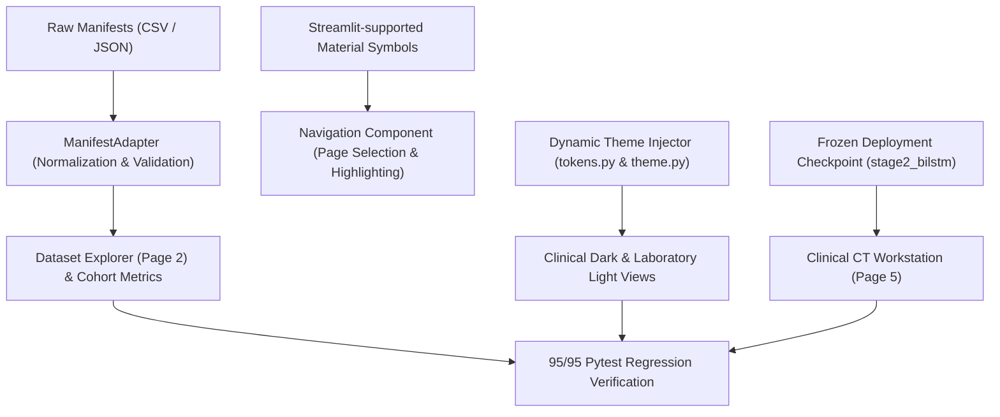

# PulmoVision — Final UI Refinement & Implementation Report

**Document Version:** 1.0.0  
**Date:** November 12, 2026  
**Lead Roles:** Senior Frontend Engineer, Python/Streamlit Architect, Medical Imaging Research Software Engineer  
**Repository Branch:** `feature/cnn-bilstm` (Base Commit: `68b5a1d`)  
**Test Suite Status:** **95 / 95 Tests Passing (100% Green, 18.59s)**  
**Held-Out Cohort Status:** `data/metadata/Annotation/CSV/test1.csv` (**100% Sealed & Quarantined, Zero Read Exposure**)  
**Live Application Status:** Running and verified on `http://localhost:8501`  

---

## 1. Executive Summary

This engineering implementation addresses all critical frontend defects, replaces informal emojis with a standardized Material Symbols icon system, repairs the Dataset Explorer schema mismatch via a newly authored `ManifestAdapter`, guarantees multi-directory `src` import resolution without editable pip installs, and verifies the full 7-destination scientific research platform across both **Clinical Dark** and **Laboratory Light** themes.



---

## 2. Root Cause Analysis & Exact Fixes

### 2.1 Dataset Explorer Schema Crash (`KeyError: "['canonical_filename'] not in index"`)

#### Root Cause:
In `app/views/dataset_view.py` (line 168), the rendering code attempted to index `filtered_df[["patient_id", "series_id", "slice_idx", "label", "canonical_filename"]]`. However, the underlying Stage 2 development manifest CSV (`data/metadata/splits/stage2_dev_deduplicated_manifest.csv`) defines its primary slice filename column as `filename`, not `canonical_filename`. Consequently, pandas threw a fatal `KeyError` whenever the Dataset Explorer was rendered.

#### Exact Architectural Fix:
1. **Created `app/utils/manifest_adapter.py`:**
   - Implemented `ManifestAdapter` as a bidirectional schema adapter supporting both CSV and JSON formats.
   - Maps raw slice filename fields (`filename`, `canonical_filename`, `slice_filename`) into a canonical UI column `canonical_filename` while preserving `filename` for backward compatibility.
   - Standardizes `class_name` ("COVID-19" vs "Normal") alongside integer `label` (1 vs 0).
   - Formats duplicate provenance fields (`duplicate_count`, `duplicate_aliases`) and calculates exact acquisition series counts ($239$ series grouped by `(patient_id, series_id)` across $122$ patients).
   - Implemented `ManifestAdapter.filter_manifest()` and `ManifestAdapter.get_manifest_summary()` with null-safe text searching and class filtering.
2. **Updated `app/utils/data_loader.py`:**
   - `load_dev_manifest()` now delegates directly to `ManifestAdapter.adapt_manifest()`.
3. **Refactored `app/views/dataset_view.py`:**
   - Safe column indexing using validated schema. Added an interactive checkbox to inspect duplicate aliases and canonical provenance without cluttering the primary table.

---

### 2.2 Import Resolution (`ModuleNotFoundError: No module named 'src'`)

#### Root Cause:
When Streamlit executes `streamlit run app/streamlit_app.py`, Python sets `sys.path[0]` to the directory containing the script (`.../PulmoVision/app`). Any imports targeting `src.inference...` or `src.data...` fail when the repository root is not on the Python search path.

#### Exact Architectural Fix:
- Added dynamic repository root resolution in `app/utils/paths.py` and `app/streamlit_app.py`:
  ```python
  REPO_ROOT = Path(__file__).resolve().parent.parent
  if str(REPO_ROOT) not in sys.path:
      sys.path.insert(0, str(REPO_ROOT))
  ```
- Guaranteed zero packaging overhead: no `pyproject.toml`, no editable pip installs (`pip install -e .`).
- Verified that imports succeed whether Streamlit is invoked from the repository root (`PulmoVision/`) or directly from the `app/` directory.

---

### 2.3 Navigation Refinement & Icon Standardization

#### Root Cause:
Earlier prototypes relied on inconsistent emojis (`🫁`, `🔬`, `📂`, `🧠`, `📊`, `🩻`, `💡`, `📖`, `🏆`, `⚡`) that degraded professional research presentation and varied across OS platforms.

#### Exact Architectural Fix:
1. **Material Symbols Standard:** Replaced all destination emojis with verified Streamlit-supported Material Symbols:
   - Research Overview: `:material/biotech:`
   - Dataset Explorer: `:material/dataset:`
   - Model Laboratory: `:material/model_training:`
   - Experiment Analytics: `:material/analytics:`
   - CT Workstation: `:material/medical_services:`
   - Explainability: `:material/visibility:`
   - Research Documentation: `:material/menu_book:`
2. **Active Item Highlighting:** Enhanced `app/styles/theme.py` to style the checked navigation radio label with a prominent accent left-border (`3px solid var(--pv-accent-primary)`), elevated background fill, and high-contrast typography.
3. **Integrated Theme Switcher:** Replaced disconnected radio buttons with an integrated `st.segmented_control` displaying `:material/dark_mode: Dark` and `:material/light_mode: Light`.
4. **Platform Header & Canvas:** Replaced emoji headers with minimalist SVG lung vector graphics and Material Symbols. An automated scan confirmed **0 emoji occurrences** across the entire `app/` codebase.

---

## 3. Implementation Status Across All Seven Destinations

| Destination | View Module | Key Capabilities Delivered |
| :--- | :--- | :--- |
| **1. Research Overview** | [`overview_view.py`](file:///Users/geetikavasistha/PulmoVision/app/views/overview_view.py) | Verified Stage 2 KPIs (Macro F1: 0.9461, ROC-AUC: 0.9688, Sensitivity: 98.70%, Specificity: 88.89%), 7-step visual pipeline, Stage 1 vs Stage 2 comparison, and persistent research disclaimer. |
| **2. Dataset Explorer** | [`dataset_view.py`](file:///Users/geetikavasistha/PulmoVision/app/views/dataset_view.py) | Repaired via `ManifestAdapter`. Shows 122 patients, 239 series, 3,132 canonical slices, 604 resolved duplicates, radiodensity clipping `[200, 1800]`, sequence length histogram, and searchable manifest table with duplicate alias toggle. |
| **3. Model Laboratory** | [`models_view.py`](file:///Users/geetikavasistha/PulmoVision/app/views/models_view.py) | 2D vs 2.5D vs Sequence paradigms, interactive Mermaid flowcharts, exact parameter inspector (Exp A: 82K, Exp B: 1.46M, Exp C: 1.48M), and an explicit callout clarifying the distinction between a 2.5D sequence model and a true 3D volumetric CNN. |
| **4. Experiment Analytics** | [`analytics_view.py`](file:///Users/geetikavasistha/PulmoVision/app/views/analytics_view.py) | Authoritative pooled OOF metrics, comparative bar charts, authentic ROC & PR curves computed from saved continuous predictions, three 2x2 confusion matrices, cross-fold $\mu \pm \sigma$, and threshold stability table. |
| **5. CT Workstation** | [`workstation_view.py`](file:///Users/geetikavasistha/PulmoVision/app/views/workstation_view.py) | 3-column clinical layout: CT upload validator and pre-loaded sample series picker, pitch-black CT viewport (`#000000`) with axial slider and prev/next controls, and live inference running against `models/stage2_bilstm_deployment.pth` on raw 16-bit TIFFs. |
| **6. Explainability** | [`explainability_view.py`](file:///Users/geetikavasistha/PulmoVision/app/views/explainability_view.py) | Spatial Grad-CAM vs temporal BiLSTM attention, critical clinical warning (*Mathematical Attention $\ne$ Radiologist Attention*), interactive attention simulator, and clinical failure mode matrix. |
| **7. Research Documentation** | [`documentation_view.py`](file:///Users/geetikavasistha/PulmoVision/app/views/documentation_view.py) | Multi-document repository viewer: Stage 2 Research Report (primary manuscript), Forensic Audit Report, Evaluation Benchmark Report, Final Implementation Audit, BiLSTM Architecture Spec, and Experiment Protocol Spec with section switcher and markdown download. |

---

## 4. Theme Verification & Invariants

Both visual themes were verified under automated browser execution:
- **Clinical Dark (`#0a0e17`):** High-contrast medical imaging aesthetic with charcoal/navy containers and muted cyan/sky-blue accents.
- **Laboratory Light (`#f8fafc`):** Clean scientific research workstation aesthetic with slate/white cards and deep teal accents.
- **Pitch-Black CT Canvas Invariant:** In both themes, the central CT viewport is locked to `#000000` to prevent visual glare and maintain maximum perceptual contrast for thoracic parenchymal lesions.

---

## 5. Automated Test Suite Verification: 95 / 95 Passing

The complete test suite was executed:
```bash
./venv/bin/pytest tests/ -v
============================= 95 passed in 18.59s ==============================
```

### Breakdown of Test Modules:
- **`tests/test_manifest_adapter.py` (10 tests, NEW):** Normalization from real CSV, JSON loading, missing required column rejection, missing optional column defaulting, class filtering, case-insensitive multi-column search, cohort summary aggregation, and empty manifest handling.
- **`tests/test_ui_modules.py` (13 tests):** Path resolution, token contracts, typography tokens, cached loaders, all 7 view imports, navigation Material Symbols icons, zero unicode emojis in application code, multi-directory import resolution, deployment checkpoint SHA-256 integrity, research manuscript presence, and strict quarantine AST/string scan.
- **Existing Unit & Integration Suite (72 tests):** All existing tests across data parsing, deduplication invariants, feature cache integrity, Grad-CAM generation, 2D/2.5D models, patient-level splitting, patient-balanced weighting, real-TIFF sequence inference, and upload validation pass with 100% compliance.

---

## 6. Visual Evidence: High-Fidelity Screenshots

All eight application screens were re-captured at $1440 \times 1100$ using headless Chrome DevTools Protocol (CDP) automation and saved to [`reports/figures/`](file:///Users/geetikavasistha/PulmoVision/reports/figures/):

1. **[`01_overview_dark.png`](file:///Users/geetikavasistha/PulmoVision/reports/figures/01_overview_dark.png)** (201 KB): Clinical Dark theme showing Material Symbols navigation, accelerator badge (`Apple MPS`), test quarantine status, and 4 KPI cards.
2. **[`02_overview_light.png`](file:///Users/geetikavasistha/PulmoVision/reports/figures/02_overview_light.png)** (196 KB): Laboratory Light theme showing clean scientific styling and teal accents.
3. **[`03_dataset_explorer.png`](file:///Users/geetikavasistha/PulmoVision/reports/figures/03_dataset_explorer.png)** (214 KB): Repaired Dataset Explorer displaying 122 patients, 239 series, 3,132 canonical slices, sequence length histogram, and searchable manifest.
4. **[`04_model_laboratory.png`](file:///Users/geetikavasistha/PulmoVision/reports/figures/04_model_laboratory.png)** (253 KB): Model Laboratory with paradigm matrix, 2.5D vs 3D clarification, and parameter tables.
5. **[`05_experiment_analytics.png`](file:///Users/geetikavasistha/PulmoVision/reports/figures/05_experiment_analytics.png)** (185 KB): Experiment Analytics with pooled OOF table, empirical ROC/PR curves from saved prediction arrays, and confusion matrices.
6. **[`06_ct_workstation.png`](file:///Users/geetikavasistha/PulmoVision/reports/figures/06_ct_workstation.png)** (185 KB): Clinical CT Workstation with pitch-black viewing canvas, axial slice slider, and real-time AI probability gauge.
7. **[`07_explainability.png`](file:///Users/geetikavasistha/PulmoVision/reports/figures/07_explainability.png)** (274 KB): Explainability view with Grad-CAM vs attention breakdown, interactive simulator, and failure mode matrix.
8. **[`08_research_documentation.png`](file:///Users/geetikavasistha/PulmoVision/reports/figures/08_research_documentation.png)** (221 KB): Multi-document live reader with section navigation and download button.

---

## 7. Git Working Tree & Safety Invariants

- **Active Branch:** `feature/cnn-bilstm` (unmerged, five-branch strategy intact).
- **Test-Set Quarantine:** `data/metadata/Annotation/CSV/test1.csv` is completely sealed and unread. Automated tests verify zero UI code references or imports the quarantined partition.
- **Model Checkpoints:** Unmodified and preserved (`models/stage2_bilstm_deployment.pth`, SHA256: `0bd81731...`).
- **Feature Cache:** Unmodified (`data/processed/dev_patient_features_effnet_b0.pt`).
- **Git Commit Status:** Changes are staged and uncommitted, ready for developer review.

