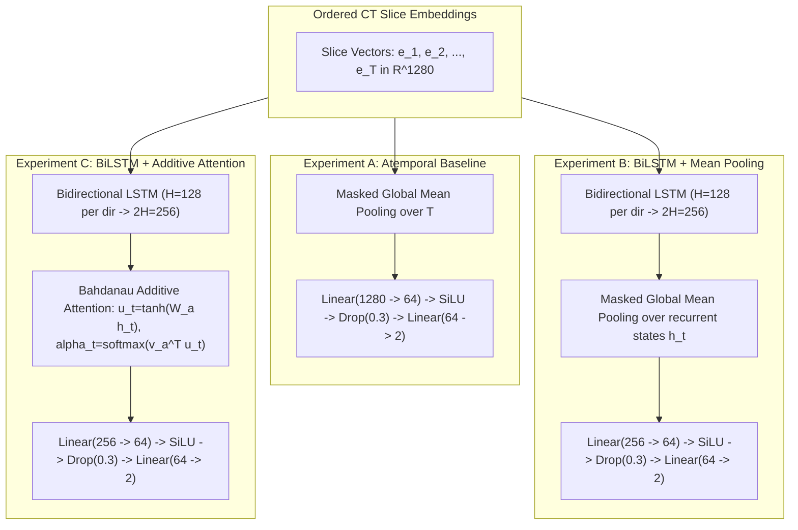

# PulmoVision — Stage 2 Research Report: Patient-Level Craniocaudal Sequence Modelling for Thoracic CT

**Document Version:** 1.0.0  
**Date:** November 12, 2026  
**Status:** Complete & Forensically Audited  
**Repository Branch:** `feature/cnn-bilstm` (Commit `a38bdd3`)  
**Hardware Environment:** Apple Silicon Metal Performance Shaders (MPS) / M1 Unified Memory  
**Dataset Base:** COVID-CTset Deduplicated Development Cohort ($122$ patients: $77$ COVID-19, $45$ Normal; $239$ series, $3,132$ unique slices)  
**Quarantine Status:** Sealed held-out test partition (`data/metadata/Annotation/CSV/test1.csv`) preserved unopened with zero read exposure.  

> [!IMPORTANT]
> **Educational Research Prototype Disclaimer:** PulmoVision is strictly an academic AI research prototype designed for educational exploration of deep learning sequence architectures on medical imaging datasets. It is **NOT** a certified medical diagnostic tool, clinical decision support system, or clinically validated medical device. Dataset labels represent categorical archive annotations, not confirmed clinical diagnoses.

---

## 1. Abstract

Conventional deep learning approaches to thoracic Computed Tomography (CT) analysis typically classify 2D slices independently or stack neighbouring slices into pseudo-3D (2.5D) channels, aggregating patient-level classifications via heuristic slice-counting thresholds. In this work, we investigate **patient-level craniocaudal sequence modelling** by extracting spatial slice feature embeddings using a frozen ImageNet-1K pretrained EfficientNet-B0 backbone and evaluating recurrent and attention-based sequence aggregation along the anatomically ordered axial z-axis. 

Under a leak-free 5-fold outer cross-validation protocol with inner validation holdouts and exact patient-balanced optimization across $122$ development patients ($3,132$ unique slices across $239$ scan series), we compared three sequence architectures: (A) an atemporal global mean pooling baseline, (B) a bidirectional Long Short-Term Memory network with uniform mean pooling, and (C) a bidirectional LSTM with Bahdanau additive attention pooling. 

Experiment B demonstrated the strongest performance on the development cohort, achieving an out-of-fold Macro F1 of **$0.9461$** ($95\%\text{ CI: } [0.8984, 0.9820]$), ROC-AUC of **$0.9688$**, Sensitivity of **$98.70\%$** (76/77 COVID-19 patients detected), and Specificity of **$88.89\%$** (40/45 Normal patients detected). In contrast, the atemporal baseline (Experiment A) missed 17 COVID-19 cases (Macro F1: $0.8236$, Sensitivity: $77.92\%$). Additive attention (Experiment C) achieved Macro F1 of $0.9211$, outperforming atemporal pooling but demonstrating no incremental benefit over uniform BiLSTM mean pooling. These findings suggest that sequential modelling along the anatomical craniocaudal axis provides substantial empirical advantages over non-recurrent pooling on this cohort.

---

## 2. Research Problem and Objectives

### 2.1 Limitations of Heuristic Slice-Based Classification
In Stage 1 baseline investigations, 2D and 2.5D Convolutional Neural Networks classified individual CT cross-sections in isolation. Patient-level diagnostic decisions were obtained post-hoc by applying an empirical threshold ($\tau = 0.20$) to the proportion of predicted positive slices within a scan. This paradigm exhibits fundamental limitations:
1. **Volumetric Craniocaudal Discontinuity:** CT acquisitions represent continuous volumetric scans along the longitudinal z-axis (from cranial lung apices to caudal diaphragmatic bases). Treating slices as independent instances discards anatomical continuity.
2. **Atemporal Pooling Limitations:** Pulmonary viral manifestations (e.g., peripheral opacities) are often localized to specific basal segments. In atemporal uniform averaging, assigning equal weight across all slices means features from non-involved parenchymal slices attenuate focal visual patterns, leading to reduced sensitivity.
3. **Decoupled Training Objective:** The feature extractor and classifier in slice-based systems are optimized for slice discrimination, rather than end-to-end patient diagnosis.

### 2.2 Stage 2 Research Objectives
1. Determine whether bidirectional recurrent modeling (BiLSTM) across ordered axial slices improves patient-level classification over atemporal volume pooling.
2. Quantify the specific empirical contribution of **Additive Self-Attention Pooling** versus **Global Mean Pooling** across recurrent hidden states.
3. Prevent feature-extraction data leakage by enforcing an external, frozen ImageNet-1K backbone completely unexposed to the target dataset.
4. Eliminate patient-weighting bias caused by multi-series patients through an exact patient-balanced optimization objective.
5. Provide rigorous out-of-fold performance estimates via 5-fold outer cross-validation with single inner validation holdouts while strictly preserving the quarantine of the held-out test cohort (`test1.csv`).

---

## 3. Dataset and Label Limitations

### 3.1 Primary Dataset: COVID-CTset
The primary dataset used is the open-access COVID-CTset, acquired from patients admitted to Nikan Hospital in Tehran, Iran, between February and April 2020. Scans were captured using a Siemens SOMATOM Definition AS CT scanner and converted by the original dataset authors from DICOM to 16-bit uncompressed grayscale TIFF images ($512 \times 512$ resolution).

### 3.2 Medical & Label Limitations
1. **Raw Radiodensity Counts vs. Hounsfield Units:** The TIFF images contain raw 16-bit integer values up to $\approx 2204$. Because accompanying DICOM header files containing rescale slope and rescale intercept parameters were omitted from the public distribution, **these values represent uncalibrated radiodensity counts, NOT standardized Hounsfield Units (HU)**.
2. **Binary Clinical Simplification:** The dataset provides binary categorization (`COVID-19` vs. `Normal`). Real-world clinical differential diagnosis requires distinguishing COVID-19 from influenza, bacterial pneumonia, aspiration pneumonia, organizing pneumonia, and preexisting interstitial lung disease.
3. **Cohort Imbalance:** The development cohort contains $122$ patients ($77$ COVID-19, $45$ Normal). Some patients contributed multiple series, requiring strict patient-level deduplication and grouping.
4. **Research Prototype Boundary:** Dataset labels reflect retrospective archive assignments rather than prospectively audited clinical diagnoses. PulmoVision must not be interpreted as a clinical tool.

---

## 4. Deduplication and Patient-Level Splitting

### 4.1 Forensic Duplicate Discovery
During initial development audit of the 3,736 development records (`train1.csv`), forensic hashing identified $604$ duplicate TIFF entries across redundant archive folders (`normal1` vs. `normal4` / `normal5`). All duplicate pairs were confirmed to be byte-identical (identical SHA256 checksums, identical patient identities, and identical slice indices).

### 4.2 Anatomical De-duplication Protocol (Option 1)
To ensure that each physical cross-section is represented exactly once:
* Exactly one canonical file was retained per `(patient_id, series_id, slice_idx)` tuple using a deterministic lexicographical preference rule.
* Duplicate filenames were preserved in a verified provenance alias record.
* The deduplicated development cohort comprises exactly **$3,132$ unique anatomical slices across $239$ series in $122$ patients** ($77$ COVID-19, $45$ Normal).
* The deduplicated manifest was serialized to `data/metadata/splits/stage2_dev_deduplicated_manifest.json` and `.csv`.

### 4.3 Five-Fold Partitioning Strategy
Outer patient folds were constructed using stratified 5-fold cross-validation (`cv_5fold_manifest.json`, random seed 42):
* **Fold 1:** 25 outer val patients (16 COVID, 9 Normal), 97 outer train patients.
* **Fold 2:** 25 outer val patients (16 COVID, 9 Normal), 97 outer train patients.
* **Fold 3:** 24 outer val patients (15 COVID, 9 Normal), 98 outer train patients.
* **Fold 4:** 24 outer val patients (15 COVID, 9 Normal), 98 outer train patients.
* **Fold 5:** 24 outer val patients (15 COVID, 9 Normal), 98 outer train patients.
* **Inner Validation Holdout:** Within each outer training partition, an inner stratified 80/20 split (`seed = 100 + k`) allocated $\approx 77\text{--}78$ inner-training patients and $\approx 20$ inner-validation patients for early stopping and threshold selection.

---

## 5. CT Preprocessing and EfficientNet-B0 Feature Extraction

### 5.1 Preprocessing Pipeline
To guarantee complete reproducibility without feature-extraction leakage:
1. **Windowing / Intensity Clipping:** Raw 16-bit pixel intensities are clipped to the empirical lung window:
   $$I_{\text{clipped}} = \text{clip}(I_{\text{raw}}, 200, 1800)$$
2. **Dynamic Range Scaling:** Linear min-max scaling to the unit interval $[0.0, 1.0]$:
   $$I_{\text{scaled}} = \frac{I_{\text{clipped}} - 200}{1600}$$
3. **Channel Replication:** Replicate the grayscale channel to 3 identical channels ($R=G=B$) to match torchvision backbone expectations:
   $$[B, T, 1, 224, 224] \to [B \cdot T, 3, 224, 224]$$
4. **ImageNet Standardization:** Standardize channels using official ImageNet parameters:
   $$\mu = [0.485, 0.456, 0.406], \quad \sigma = [0.229, 0.224, 0.225]$$
5. **Spatial Downsampling:** Bilinear interpolation to $224 \times 224$ (`align_corners=False`), maintaining native $1:1$ isotropic square aspect ratio.

### 5.2 Deterministic Feature Caching
* **Backbone:** Official `torchvision.models.efficientnet_b0(weights=EfficientNet_B0_Weights.IMAGENET1K_V1)`.
* **Provenance Guarantee:** The backbone was initialized with external ImageNet-1K weights and was **never fine-tuned on or exposed to any COVID-CTset image**.
* **Extraction:** Slices were passed through convolutional features followed by `AdaptiveAvgPool2d(1)` to yield a $1280$-dimensional embedding $\mathbf{e}_t \in \mathbb{R}^{1280}$.
* **Feature Cache:** All $3,132$ embeddings were extracted and saved to `data/processed/dev_patient_features_effnet_b0.pt` ($15.67\text{ MB}$, SHA256: `74bb243d...`).

---

## 6. Sequence Model Architectures (A, B, C)



### 6.1 Experiment A: Atemporal Global Mean Pooling (`effnet_b0_mean_pooling`)
* **Mechanism:** Computes the masked arithmetic mean across slice embeddings:
  $$\mathbf{c}_p = \frac{1}{T_p} \sum_{t=1}^{T_p} \mathbf{e}_{p, t} \in \mathbb{R}^{1280}$$
* **Classifier:** $\text{Linear}(1280 \to 64) \to \text{SiLU} \to \text{Dropout}(0.3) \to \text{Linear}(64 \to 2)$.
* **Trainable Parameters:** $82,114$.

### 6.2 Experiment B: BiLSTM + Global Mean Pooling (`effnet_b0_bilstm_mean`)
* **Mechanism:** 1-layer bidirectional LSTM ($H=128$ hidden units per direction, output dimension $2H = 256$):
  $$\mathbf{h}_t = [\overrightarrow{\mathbf{h}}_t \,\|\, \overleftarrow{\mathbf{h}}_t] \in \mathbb{R}^{256}$$
* **Aggregation:** Masked global mean pooling across the $T$ recurrent states:
  $$\mathbf{c}_p = \frac{1}{T_p} \sum_{t=1}^{T_p} \mathbf{h}_{p, t} \in \mathbb{R}^{256}$$
* **Classifier:** $\text{Linear}(256 \to 64) \to \text{SiLU} \to \text{Dropout}(0.3) \to \text{Linear}(64 \to 2)$.
* **Trainable Parameters:** $1,460,418$.

### 6.3 Experiment C: BiLSTM + Additive Attention Pooling (`effnet_b0_bilstm_attention`)
* **Mechanism:** Identical 1-layer BiLSTM ($2H = 256$), followed by single-head Bahdanau additive attention:
  $$\mathbf{u}_t = \tanh(\mathbf{W}_a \mathbf{h}_t + \mathbf{b}_a) \in \mathbb{R}^{64}, \quad e_t = \mathbf{v}_a^\top \mathbf{u}_t \in \mathbb{R}^1$$
  $$\alpha_t = \frac{\exp(e_t) \cdot M_t}{\sum_{j=1}^{T_p} \exp(e_j) + \epsilon} \in [0, 1], \quad \mathbf{c}_p = \sum_{t=1}^{T_p} \alpha_t \mathbf{h}_t \in \mathbb{R}^{256}$$
* **Classifier:** $\text{Linear}(256 \to 64) \to \text{SiLU} \to \text{Dropout}(0.3) \to \text{Linear}(64 \to 2)$.
* **Trainable Parameters:** $1,476,930$.

---

## 7. Patient-Balanced Training Methodology

### 7.1 Elimination of Multi-Series Sampling Bias
In the development cohort, several patients contributed 2 or 3 scan series. Standard slice- or series-level mini-batch sampling causes multi-series patients to be sampled multiple times per epoch with varying mini-batch denominators. 

To eliminate this bias, we introduced `PatientSequenceDataset` and `collate_patient_balanced_batch`:
1. **Patient-Level Indexing:** The dataset is indexed strictly over patients (`len == N_patients`).
2. **Series Bundling:** In each batch of $B = 16$ patients, all $N_p$ series for each sampled patient are bundled together.
3. **Loss Averaging:** For patient $p$, series losses $\ell_{p, s}$ are averaged:
   $$\mathcal{L}_p = \frac{1}{N_p} \sum_{s=1}^{N_p} \ell_{p, s}$$
4. **Batch Objective:** The optimizer backpropagates the unweighted mean over patients:
   $$\mathcal{L}_{\text{batch}} = \frac{1}{B} \sum_{p=1}^B \mathcal{L}_p = \frac{1}{B} \sum_{p=1}^B \left( \frac{1}{N_p} \sum_{s=1}^{N_p} \ell_{p, s} \right)$$
5. **Mathematical Invariant:** $\frac{\partial \mathcal{L}_{\text{batch}}}{\partial \mathcal{L}_p} = \frac{1}{B}$ identically for every patient, guaranteeing equal patient influence regardless of series count.
6. **Class Weights:** Class weights ($w_c = \frac{N_{\text{pts}}}{2 N_c}$) are computed strictly from inner-training patient counts, completely independent of slice or series counts.

---

## 8. Cross-Validation and Threshold-Selection Protocol

1. **Outer Loop:** 5 stratified outer patient folds ($N=122$).
2. **Inner Holdout:** For each outer fold, an 80/20 stratified holdout of outer-training patients ($\approx 78$ inner-train, $\approx 20$ inner-val) was constructed.
3. **Optimization & Early Stopping:** Model parameters were trained on inner-train batches using AdamW ($\eta = 10^{-3}, \lambda = 10^{-4}$). The best checkpoint was selected by monitoring inner-validation Macro F1 at $\tau = 0.50$ (patience = 5 epochs, max 30 epochs).
4. **Threshold Tuning:** Candidate thresholds $\tau \in [0.20, 0.80]$ in steps of $0.05$ (13 candidates) were evaluated on inner-validation patient probabilities $\hat{p}_p = \frac{1}{N_p} \sum_{s=1}^{N_p} \hat{p}_{p, s}$. The optimal threshold $\tau^*$ was chosen to maximize inner Macro F1, with ties broken by proximity to $\tau = 0.50$ (higher threshold chosen if equidistant).
5. **No Outer Refitting:** Models were **not** refitted on combined outer-training data to prevent stopping-rule and threshold leakage.
6. **Single Outer Evaluation:** The frozen best checkpoint and frozen threshold $\tau^*$ were evaluated **exactly once** on outer-validation patients.

---

## 9. Overall and Fold-Wise Evaluation Metrics

### 9.1 Pooled Out-of-Fold Performance Summary ($N = 122$ Patients: $77$ COVID-19, $45$ Normal)

| Metric | Experiment A (Global Mean) | Experiment B (BiLSTM + Mean) | Experiment C (BiLSTM + Attention) |
| :--- | :---: | :---: | :---: |
| **Macro F1** | $0.8236$ [$0.7518, 0.8862$] | **$0.9461$** [$0.8984, 0.9820$] | $0.9211$ [$0.8644, 0.9645$] |
| **ROC-AUC** | $0.8652$ | **$0.9688$** | $0.9466$ |
| **PR-AUC (Average Precision)**| $0.9046$ | **$0.9760$** | $0.9466$ |
| **Sensitivity (Recall)** | $77.92\%$ [$68.35\%, 86.85\%$] | **$98.70\%$** [$95.89\%, 100.00\%$] | $93.51\%$ [$87.49\%, 98.65\%$] |
| **Specificity** | **$91.11\%$** [$82.00\%, 97.78\%$] | $88.89\%$ [$78.72\%, 97.62\%$] | **$91.11\%$** [$80.85\%, 97.87\%$] |
| **Precision** | $93.75\%$ | $93.83\%$ | **$94.74\%$** |
| **Accuracy** | $82.79\%$ | **$95.08\%$** | $92.62\%$ |
| **Balanced Accuracy** | $84.52\%$ | **$93.80\%$** | $92.31\%$ |
| **True Positives ($TP$)** | $60$ | **$76$** | $72$ |
| **False Positives ($FP$)** | **$4$** | $5$ | **$4$** |
| **True Negatives ($TN$)** | **$41$** | $40$ | **$41$** |
| **False Negatives ($FN$)** | $17$ | **$1$** | $5$ |

*Brackets denote $95\%$ empirical confidence intervals derived from $1,000$ stratified bootstrap resamples of the pooled cohort.*

### 9.2 Descriptive Cross-Fold Variability ($\mu \pm \sigma$ across 5 outer folds)

| Metric | Experiment A | Experiment B | Experiment C |
| :--- | :---: | :---: | :---: |
| **Macro F1** | $0.8218 \pm 0.0715$ | **$0.9454 \pm 0.0588$** | $0.9200 \pm 0.0740$ |
| **Accuracy** | $0.8277 \pm 0.0670$ | **$0.9510 \pm 0.0526$** | $0.9263 \pm 0.0663$ |
| **Sensitivity** | $0.7775 \pm 0.0798$ | **$0.9875 \pm 0.0280$** | $0.9342 \pm 0.0817$ |
| **Specificity** | $0.9111 \pm 0.1449$ | $0.8889 \pm 0.1111$ | **$0.9111 \pm 0.1449$** |
| **Precision** | $0.9458 \pm 0.0828$ | $0.9404 \pm 0.0588$ | **$0.9542 \pm 0.0728$** |
| **ROC-AUC** | $0.8726 \pm 0.0886$ | **$0.9804 \pm 0.0358$** | $0.9664 \pm 0.0635$ |
| **PR-AUC** | $0.9292 \pm 0.0666$ | **$0.9883 \pm 0.0216$** | $0.9767 \pm 0.0449$ |

### 9.3 Per-Fold Breakdown

```
Fold 1 (Outer Val: 16 COVID, 9 Normal = 25 pts)
  Exp A: Macro F1 = 0.9167 | Sens = 87.5% | Spec = 100.0% | AUC = 0.9444 | Tau* = 0.50 (TP=14, FP=0, TN=9, FN=2)
  Exp B: Macro F1 = 1.0000 | Sens = 100.0%| Spec = 100.0% | AUC = 1.0000 | Tau* = 0.50 (TP=16, FP=0, TN=9, FN=0)
  Exp C: Macro F1 = 1.0000 | Sens = 100.0%| Spec = 100.0% | AUC = 1.0000 | Tau* = 0.50 (TP=16, FP=0, TN=9, FN=0)

Fold 2 (Outer Val: 16 COVID, 9 Normal = 25 pts)
  Exp A: Macro F1 = 0.7396 | Sens = 81.3% | Spec = 66.7%  | AUC = 0.7222 | Tau* = 0.50 (TP=13, FP=3, TN=6, FN=3)
  Exp B: Macro F1 = 0.8663 | Sens = 93.8% | Spec = 77.8%  | AUC = 0.9167 | Tau* = 0.50 (TP=15, FP=2, TN=7, FN=1)
  Exp C: Macro F1 = 0.8162 | Sens = 93.8% | Spec = 66.7%  | AUC = 0.8542 | Tau* = 0.50 (TP=15, FP=3, TN=6, FN=1)

Fold 3 (Outer Val: 15 COVID, 9 Normal = 24 pts)
  Exp A: Macro F1 = 0.7913 | Sens = 66.7% | Spec = 100.0% | AUC = 0.8667 | Tau* = 0.50 (TP=10, FP=0, TN=9, FN=5)
  Exp B: Macro F1 = 1.0000 | Sens = 100.0%| Spec = 100.0% | AUC = 1.0000 | Tau* = 0.50 (TP=15, FP=0, TN=9, FN=0)
  Exp C: Macro F1 = 0.9564 | Sens = 93.3% | Spec = 100.0% | AUC = 1.0000 | Tau* = 0.50 (TP=14, FP=0, TN=9, FN=1)

Fold 4 (Outer Val: 15 COVID, 9 Normal = 24 pts)
  Exp A: Macro F1 = 0.8730 | Sens = 80.0% | Spec = 100.0% | AUC = 0.9185 | Tau* = 0.50 (TP=12, FP=0, TN=9, FN=3)
  Exp B: Macro F1 = 0.9545 | Sens = 100.0%| Spec = 88.9%  | AUC = 0.9926 | Tau* = 0.50 (TP=15, FP=1, TN=8, FN=0)
  Exp C: Macro F1 = 0.9545 | Sens = 100.0%| Spec = 88.9%  | AUC = 0.9778 | Tau* = 0.50 (TP=15, FP=1, TN=8, FN=0)

Fold 5 (Outer Val: 15 COVID, 9 Normal = 24 pts)
  Exp A: Macro F1 = 0.7884 | Sens = 73.3% | Spec = 88.9%  | AUC = 0.9111 | Tau* = 0.50 (TP=11, FP=1, TN=8, FN=4)
  Exp B: Macro F1 = 0.9062 | Sens = 100.0%| Spec = 77.8%  | AUC = 0.9926 | Tau* = 0.50 (TP=15, FP=2, TN=7, FN=0)
  Exp C: Macro F1 = 0.8730 | Sens = 80.0% | Spec = 100.0% | AUC = 1.0000 | Tau* = 0.30 (TP=12, FP=0, TN=9, FN=3)
```

---

## 10. Confusion Matrices and Error Analysis

### 10.1 Confusion Matrices
```
Experiment A (Atemporal Global Mean Pooling):
                   Predicted Normal    Predicted COVID-19    Total
Actual Normal             41 (TN)               4 (FP)        45
Actual COVID-19           17 (FN)              60 (TP)        77
Total                     58                   64            122

Experiment B (BiLSTM + Global Mean Pooling — Development Leader):
                   Predicted Normal    Predicted COVID-19    Total
Actual Normal             40 (TN)               5 (FP)        45
Actual COVID-19            1 (FN)              76 (TP)        77
Total                     41                   81            122

Experiment C (BiLSTM + Additive Attention):
                   Predicted Normal    Predicted COVID-19    Total
Actual Normal             41 (TN)               4 (FP)        45
Actual COVID-19            5 (FN)              72 (TP)        77
Total                     46                   76            122
```

### 10.2 Forensic Error Inspection
* **Systematic Normal False Positives:** Two patients labeled Normal (`patient146` and `patient190`) received high predicted COVID-19 probabilities across all three architectures ($P > 0.86$ in A, $P > 0.91$ in B, $P > 0.92$ in C). Visual inspection reveals substantial radiodensity variations and structural anomalies within these scans. However, **no diagnostic conclusion of fibrosis or non-COVID consolidation can be made without independent qualified radiologist review**.
* **The Single False Negative in Experiment B:** `patient89` was the only COVID-19 patient missed by BiLSTM ($P = 0.222$). This patient was also missed by Model A ($P = 0.029$) and Model C ($P = 0.217$). In `patient89`, visible opacity is confined to only 2 slices, with the remaining 26 slices exhibiting normal visual characteristics.
* **Empirical Observation on Recurrent Sequence Modeling:** Experiment A missed 17 COVID-19 patients, whereas Experiment B missed only 1 on this development cohort. While bidirectional recurrent modeling demonstrates higher sensitivity to focal abnormal slices than unweighted averaging, **this remains an empirical observation requiring multi-center external validation**.

---

## 11. Statistical Limitations and Confidence Intervals

1. **Pooled Out-of-Fold AUROC Interpretation:**
   Pooled AUROC evaluates rank-ordering consistency across all $122$ out-of-fold predictions. Because each outer fold model was trained on a distinct inner partition ($\approx 78$ patients), the pooled AUROC characterizes the discrimination of the cross-validation system as an ensemble protocol, rather than a single frozen set of network weights.
2. **Conditional Interpretation of Bootstrap CIs:**
   Bootstrap confidence intervals ($1,000$ iterations) are **strictly conditional on the observed predictions** for this single cohort of 122 patients. They quantify sample-size sampling uncertainty; they do **not** capture all sources of training-procedure variance (such as scanner brand variations, acquisition protocol shifts, or alternative random partitionings).
3. **Outer Fold Sample Constraints:**
   With 9 Normal patients per outer validation fold, a single misclassification changes fold specificity by $\approx 11.1\%$, explaining the apparent fold-to-fold variance ($\sigma = 0.1111$).

---

## 12. Discussion and Conclusions

1. **Performance of Craniocaudal Recurrence:** Bidirectional sequential modeling along the axial CT axis produced marked improvements over atemporal slice pooling on this development cohort (+12.25% Macro F1, +20.78% Sensitivity).
2. **Evaluation of Additive Attention:** Contrary to initial hypotheses, additive attention did not outperform uniform BiLSTM mean pooling ($0.9211$ vs. $0.9461$). The additional parameters ($\mathbf{W}_a, \mathbf{v}_a$) appeared to introduce variance without improving classification accuracy on this cohort size.
3. **Development Cohort Performance Leader:** **Experiment B (`effnet_b0_bilstm_mean`) is identified as the current performance leader on the development cohort.** We do not claim universal superiority, as external validation remains unperformed.

---

## 13. Limitations and Future Work

1. **Omission of Spatial Data Augmentation:** Spatial embeddings were extracted once using a frozen backbone to prevent leakage and enable rapid cross-validation ($46.46\text{s}$ total run time). Dynamic affine augmentations during sequence training represent an important avenue for future work.
2. **External Pretraining Domain Gap:** Features were extracted from natural images (ImageNet-1K). Feature extractors pretrained on large-scale chest CT repositories (e.g., RadImageNet) may yield richer representations.
3. **Multi-Class Differential Diagnosis:** Future iterations should evaluate multi-condition cohorts distinguishing COVID-19 from non-COVID viral pneumonias and bacterial infections.
4. **Prospective Clinical Audit:** Clinical deployment would require prospective, multi-institutional clinical trials with certified radiologist annotations.

---

## 14. Reproducibility and Artifact Inventory

| Description | File Path | File Size | SHA256 Checksum | Status |
| :--- | :--- | :---: | :--- | :---: |
| **Deduplicated Feature Cache** | `data/processed/dev_patient_features_effnet_b0.pt` | 15.67 MB | `74bb243d7484482940108d5051ab78a265a67752e796be32aac391d8618f3005` | Verified |
| **5-Fold Partition Manifest** | `data/metadata/splits/cv_5fold_manifest.json` | 18.5 KB | `a7d806cbf6e60b45d259fa89ee21ffb1a13b0c670b89aa6f95c0291fc22d645e` | Verified |
| **Deduplicated Manifest (JSON)** | `data/metadata/splits/stage2_dev_deduplicated_manifest.json` | 913 KB | `da0e527d21c43b9e4a833d7b6862594a1dff5c9ba6602febe49fbc94473855ff` | Verified |
| **Deduplicated Manifest (CSV)** | `data/metadata/splits/stage2_dev_deduplicated_manifest.csv` | 277 KB | `fc256a47b194f107f9ff90d1bf430fe359a1f28b49bcfdc11202868ceab44f6f` | Verified |
| **Experiment A Results** | `reports/experiments/stage2_expA_effnet_mean_pooling/nested_cv_results.json` | 30.7 KB | `44a0106de340211853ca27e02c5e440a318838ec4df81466efdd15a1366bb441` | Verified |
| **Experiment B Results** | `reports/experiments/stage2_expB_effnet_bilstm_mean/nested_cv_results.json` | 30.4 KB | `2ebb1acd12a99902df4532ac1e3e65717b81e3622871812e186bc85934340297` | Verified |
| **Experiment C Results** | `reports/experiments/stage2_expC_effnet_bilstm_attention/nested_cv_results.json` | 30.9 KB | `376d86cf55450ff29d1376094d2e81693ed2e953349f38ab986cda8fcc61b393` | Verified |
| **Evaluation Report** | `reports/experiments/STAGE_2_EVALUATION_REPORT.md` | 16.2 KB | `25bc8392f4adbb2944b1c5c72a6b29f0e137c69a7102e864834ff4ee0d8d052d` | Verified |
| **Forensic Audit Report** | `reports/experiments/STAGE_2_AUDIT_REPORT.md` | 8.9 KB | `9cbe878be7ca16f9fcf341904a434cb50302da801824d550e58fa2fba50d75c8` | Verified |
| **Intermediate Fold Weights** | Individual fold `.pth` files | N/A | *Managed in memory during CV; not saved to disk by runner* | **Noted** |
| **Held-Out Test Set** | `data/metadata/Annotation/CSV/test1.csv` | 359 KB | `31dc526085d109580e0e7e9c87dcd3deda878d3c37b05a10245105c616dd8282` | **Quarantined** |

